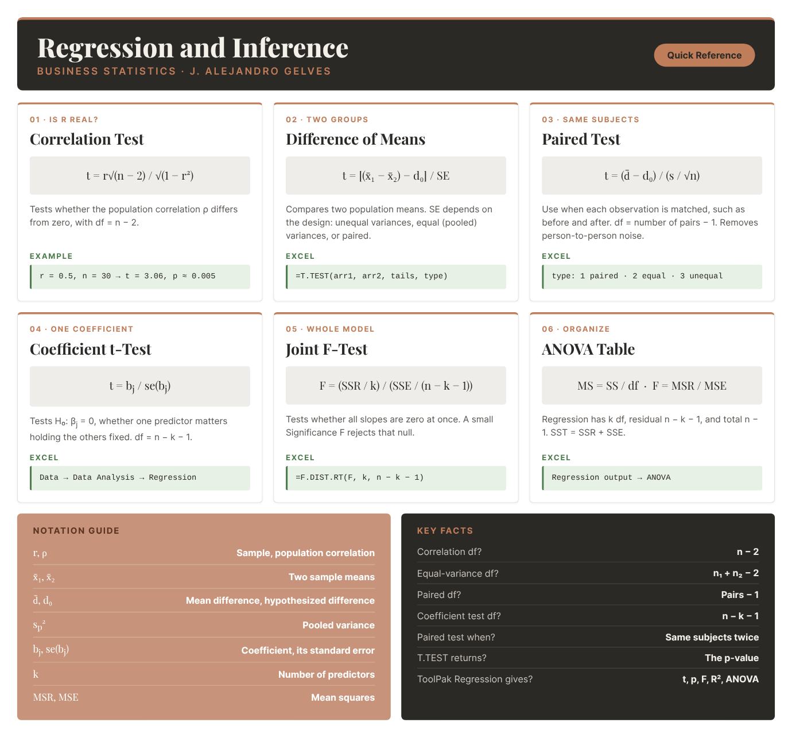

```{=html}
<style>
details {
  background-color: #F8F9FA;
  padding: 5px;
  border: 1px solid #ddd; /* Light border */
  border-radius: 5px; /* Rounded corners */
  margin: 10px 0; /* Spacing */
}

details summary {
  cursor: pointer; /* Pointer cursor for interactivity */
}
</style>
```

# Regression and Inference

In Regression I and II we described how variables move together. We measured the strength of a relationship with the correlation coefficient, and we summarized it with a regression line. In Inference I through III we learned that any statistic calculated from a sample carries sampling error, and that a hypothesis test helps us decide whether a pattern in a sample is strong enough to tell us something about the population. This final chapter brings the two ideas together. We ask whether the relationships we find in a sample are real, or whether they could simply be the result of sampling error.

Specifically, we will test whether:

- a correlation is different from zero,
- the means of two groups are different (using unpaired and paired samples),
- a regression coefficient is different from zero, and
- a regression model, as a whole, helps explain the dependent variable.

The first three tests follow the logic you already know from Inference III. We compare what we observe in the sample with what we would expect if there were no relationship, and we measure that distance in standard errors:

::: callout-formula
**THE GENERAL TEST STATISTIC** $$t=\frac{\text{estimate}-\text{hypothesized value}}{\text{standard error of the estimate}}$$
:::

The estimate changes from section to section (a correlation, a difference of means, a regression slope), and so does its standard error. The idea stays the same. A test statistic close to zero means the sample is consistent with the null hypothesis. A test statistic far from zero means the sample would be unusual if the null were true. Keep this formula in mind as you read the chapter. The last test, the $F$-test, works with a ratio instead, and we explain it at the end of the chapter.

## Correlation Significance

Recall from Regression I that the correlation coefficient $r_{xy}$ measures the strength and direction of the linear relationship between two variables. The correlation we calculate comes from a sample, so it carries sampling error just like the sample mean. If we drew a different sample, we would get a slightly different $r_{xy}$. This means that a sample correlation is almost never exactly zero, even when the two variables are unrelated in the population. A correlation of $0.2$ might reflect a real relationship, or it might be the result of chance.

To decide, we test the **population correlation** $\rho$ (the Greek letter "rho"). The null hypothesis states that there is no relationship (or a relationship in the direction we are not interested in). The hypotheses take one of three forms:

- $H_0: \rho \geq 0$ vs. $H_a: \rho < 0$: left-tailed
- $H_0: \rho \leq 0$ vs. $H_a: \rho > 0$: right-tailed
- $H_0: \rho = 0$ vs. $H_a: \rho \ne 0$: two-tailed

Use a one-tailed test when you have a reason to expect a particular direction (for example, that price and quantity demanded are negatively related), and a two-tailed test when you only want to know whether a relationship exists.

::: callout-formula
**CORRELATION TEST STATISTIC** $$t = \frac{r_{xy}\sqrt{n-2}}{\sqrt{1-r_{xy}^2}}$$ with degrees of freedom $df = n - 2$, where $r_{xy}$ is the sample correlation coefficient and $n$ is the sample size.
:::

The formula is easier to read than it looks. The numerator grows with $r_{xy}$, so stronger correlations produce larger test statistics. It also grows with the sample size, so the same correlation is more convincing when it comes from $300$ observations than when it comes from $10$. The denominator, $\sqrt{1-r_{xy}^2}$, shrinks as the correlation gets closer to $1$ or $-1$, which makes the test statistic even larger for very strong correlations. We lose two degrees of freedom because the correlation is closely tied to a regression line, which requires estimating two values from the data (an intercept and a slope). We will return to this connection later in the chapter.

::: callout-example
**Example:** A sample of $n = 30$ shows a correlation of $r = 0.5$ between advertising and sales. Testing $H_0: \rho = 0$ against $H_a: \rho \ne 0$: $$t = \frac{0.5\sqrt{30-2}}{\sqrt{1-0.5^2}} = \frac{0.5 \times 5.29}{0.866} = 3.06$$ With $df = 28$, the two-tailed p-value is about $0.005$. Because $0.005 < 0.05$, we reject the null and conclude the correlation is statistically significant. If advertising and sales were unrelated, a sample of $30$ would produce a correlation this far from zero only about $5$ times in $1{,}000$.
:::

Note that statistically significant does not mean strong or important. With a very large sample, even a correlation of $0.05$ can be statistically significant. The test only tells us that the correlation is unlikely to be exactly zero. Always look at the size of $r_{xy}$ as well as the p-value.

## Difference of Means Tests

Many business questions compare two groups. Does a new store layout raise average sales? Do customers in two regions spend different amounts? Do employees who took a training program perform better than those who did not? In each case there are two populations with means $\mu_1$ and $\mu_2$, and we want to know whether the difference $\mu_1-\mu_2$ is different from zero (or from some other value $d_0$).

We estimate the population difference with the sample difference $\bar{x}_1-\bar{x}_2$. Once again, this difference carries sampling error. Even if the two populations had exactly the same mean, two samples would almost never produce the same sample mean. The question is whether the gap we observe is larger than what sampling error alone would produce. The hypotheses take the familiar three forms:

- $H_0: \mu_1-\mu_2 \geq d_0$ vs. $H_a: \mu_1-\mu_2 < d_0$: left-tailed
- $H_0: \mu_1-\mu_2 \leq d_0$ vs. $H_a: \mu_1-\mu_2 > d_0$: right-tailed
- $H_0: \mu_1-\mu_2 = d_0$ vs. $H_a: \mu_1-\mu_2 \ne d_0$: two-tailed

In most applications $d_0=0$, so the null hypothesis states that the two means are equal (or that the difference points in the direction we are not interested in).

Before choosing a test, ask how the two samples were collected. If each observation in one sample is matched to one observation in the other (the same people measured twice, or the same stores before and after a promotion), the samples are **paired**. If the two samples come from separate groups with no link between them, the samples are **unpaired** (or independent). We begin with the unpaired case.

### Unpaired Samples {.unnumbered}

Following the general test statistic, we divide the observed gap by its standard error. So what is the standard error of a difference of two means? From Inference I we know that the variance of a single sample mean is $\sigma^2/n$. Each sample mean wobbles around its own population mean, independently of the other. When we take the difference, these wobbles do not cancel out. They add up. For independent samples, the variance of the difference is the sum of the two variances:

$$Var(\bar{x}_1-\bar{x}_2)=\frac{\sigma_1^2}{n_1}+\frac{\sigma_2^2}{n_2}$$

It may seem strange that we add variances when we subtract means. Think of two noisy measurements. Each one can be off by a little in either direction, so the gap between them can be off because of the first measurement, the second one, or both. Two sources of uncertainty make the difference less certain than either mean on its own.

In practice we do not know $\sigma_1$ and $\sigma_2$, so we replace them with the sample standard deviations $s_1$ and $s_2$. This leads to two versions of the test, depending on whether we believe the two populations have the same variance.

**Unequal variances (Welch's test).** If we have no reason to believe the population variances are equal, each sample keeps its own variance:

::: callout-formula
**UNPAIRED TEST, UNEQUAL VARIANCES (WELCH)** $$t = \frac{(\bar{x}_1 - \bar{x}_2) - d_0}{\sqrt{\frac{s_1^2}{n_1} + \frac{s_2^2}{n_2}}} \qquad df=\frac{(a+b)^2}{\frac{a^2}{n_1-1}+\frac{b^2}{n_2-1}}$$ where $a=s_1^2/n_1$ and $b=s_2^2/n_2$ are the two pieces of the variance of the difference. Round the degrees of freedom down to a whole number.
:::

The degrees of freedom formula, due to the statistician Bernard Welch, looks intimidating, but its job is simple. Because we use $s_1$ and $s_2$ in place of $\sigma_1$ and $\sigma_2$, the test statistic does not follow a $t$-distribution exactly. Welch's formula finds the $t$-distribution that best approximates it. The result always falls between the smaller of $n_1-1$ and $n_2-1$ and the total $n_1+n_2-2$:

- If one sample is much noisier (or much smaller) than the other, its piece of the variance dominates, and the degrees of freedom move toward that sample's $n-1$. The test is only as reliable as its weakest sample.
- If both samples contribute equally to the variance, the degrees of freedom move toward $n_1+n_2-2$.

Since the result is usually not a whole number, we round it down. This is the cautious choice: fewer degrees of freedom mean fatter tails and a slightly larger p-value.

**Equal variances (pooled test).** If we believe the two populations are equally spread out, there is a single variance to estimate, and we can combine both samples to estimate it. The **pooled variance** is a weighted average of the two sample variances, where each sample is weighted by its degrees of freedom:

::: callout-formula
**UNPAIRED TEST, EQUAL VARIANCES (POOLED)** $$s_p^2=\frac{(n_1-1)s_1^2+(n_2-1)s_2^2}{n_1+n_2-2} \qquad t = \frac{(\bar{x}_1 - \bar{x}_2) - d_0}{\sqrt{s_p^2\left(\frac{1}{n_1} + \frac{1}{n_2}\right)}}$$ with degrees of freedom $df = n_1 + n_2 - 2$.
:::

Pooling uses all $n_1+n_2$ observations to estimate one variance, which gives a more precise estimate and more degrees of freedom. The cost is that if the variances are in fact different, the pooled test can be misleading.

**Which one should you use?** Use the pooled test when there is a good reason to believe the two populations are equally spread out (for example, when both groups are drawn from the same pool) and the sample standard deviations are similar. A common rule of thumb is that the larger sample standard deviation should be no more than twice the smaller one. When in doubt, use Welch's test. It works well whether or not the variances are equal, which makes it the safer choice.

::: callout-example
**Example (unpaired).** A company evaluates a training program by recording a productivity score for six employees who took the program and six *different* employees who did not:

| Took the program | Did not take the program |
|:----------------:|:------------------------:|
|        23        |            20            |
|        36        |            32            |
|        27        |            25            |
|        43        |            40            |
|        31        |            28            |
|        39        |            35            |

**Step 1: State the hypotheses.** We want to know whether the two group means differ, so we test $H_0: \mu_1 - \mu_2 = 0$ against $H_a: \mu_1 - \mu_2 \ne 0$. We have no strong reason to assume equal variances, so we use Welch's test.

**Step 2: Summarize each sample.** The group that took the program has $\bar{x}_1 = 33.17$ and $s_1^2 = 56.97$. The group that did not has $\bar{x}_2 = 30.00$ and $s_2^2 = 51.60$.

**Step 3: Calculate the standard error and the test statistic.** The two pieces of the variance are $a = 56.97/6 = 9.49$ and $b = 51.60/6 = 8.60$, so: $$t = \frac{(33.17 - 30.00) - 0}{\sqrt{9.49 + 8.60}} = \frac{3.17}{4.25} = 0.74$$

**Step 4: Calculate the degrees of freedom.** $$df=\frac{(9.49+8.60)^2}{\frac{9.49^2}{5}+\frac{8.60^2}{5}}=\frac{327.4}{18.03+14.79}=9.98$$ which we round down to $9$. Since both samples contribute about equally, the result is close to the maximum of $n_1+n_2-2=10$.

**Step 5: Find the p-value and decide.** With $t = 0.74$ and $df = 9$, the two-tailed p-value is roughly $0.48$. Because $0.48 > 0.05$, we fail to reject the null. The gap of $3.17$ points is small compared with the large variation *between* employees (scores range from $20$ to $43$), so we cannot conclude that the program helped.

Since both groups have six employees and similar standard deviations, the pooled test is also reasonable here. The pooled variance is $s_p^2 = \frac{5(56.97) + 5(51.60)}{10} = 54.28$, which gives a standard error of $\sqrt{54.28\left(\frac{1}{6}+\frac{1}{6}\right)} = 4.25$, the same $t = 0.74$, and $df = 10$. The p-value is about $0.47$, so the conclusion does not change. When the two samples have the same size, the two versions always produce the same test statistic and differ only in their degrees of freedom.
:::

### Paired Samples {.unnumbered}

When the samples are paired, we can take a shortcut. For each pair, we calculate the difference $d_i$ (for example, the "after" score minus the "before" score). Once we have the differences, the two samples become a single sample of differences, and we can apply the one-sample $t$-test from Inference III to them. The null hypothesis states that the population mean difference $\mu_d$ equals $d_0$ (usually zero, meaning no change).

::: callout-formula
**PAIRED TEST** $$t=\frac{\bar{d} - d_0}{s_d / \sqrt{n}}$$ where $\bar{d}$ and $s_d$ are the mean and standard deviation of the differences, and $n$ is the number of **pairs**. The degrees of freedom are $df = n - 1$.
:::

::: callout-example
**Example (paired).** Now suppose the company measured the same six employees *before and after* the program, so every "after" score is matched to that person's own "before" score:

| Employee | Before | After | Difference |
|:--------:|:------:|:-----:|:----------:|
|    1     |   20   |  23   |     3      |
|    2     |   32   |  36   |     4      |
|    3     |   25   |  27   |     2      |
|    4     |   40   |  43   |     3      |
|    5     |   28   |  31   |     3      |
|    6     |   35   |  39   |     4      |

These are the same numbers as in the unpaired example, so the group means are identical ($30.00$ before, $33.17$ after). The difference is that we now work with each person's change. The individual gains are remarkably consistent: $\bar{d} = 3.17$ with $s_d = 0.75$. Testing $H_0: \mu_d = 0$ against $H_a: \mu_d \ne 0$: $$t = \frac{\bar{d} - 0}{s_d / \sqrt{n}} = \frac{3.17}{0.75 / \sqrt{6}} = 10.30$$ With $df = 6 - 1 = 5$ (six *pairs*, not twelve observations), the two-tailed p-value is about $0.0001$. Because $0.0001 < 0.05$, we reject the null: the program raised productivity.
:::

The two examples use the **same numbers** yet reach opposite conclusions, and the reason is the design. The unpaired test must carry the large variation *between* employees, and that noise hides the modest improvement. Some employees simply score higher than others, with or without training. The paired test removes this person-to-person variation by comparing each employee with themselves. What is left is a small, consistent gain that stands out sharply (the standard deviation drops from about $7.5$ to $0.75$). Whenever the data are naturally matched, pairing is the more powerful choice. Keep in mind, however, that you cannot choose the test after seeing the results. The test must match how the data were collected.

## Regression Inference

In Regression II we estimated regression lines and measured how well they fit. Those lines were calculated from a sample. If we collected a different sample, we would get a different intercept and different slopes. In other words, regression coefficients carry sampling error, just like the sample mean and the correlation. In this section we write the estimated coefficients as $b_j$ (the $\hat{\beta}_j$ of Regression II) and use $\beta_j$ for the unknown population coefficients that we are trying to learn about.

### Why Test Whether a Coefficient Equals Zero? {.unnumbered}

Consider the simple regression model in the population, $y = \beta_0 + \beta_1 x + \varepsilon$. Ask yourself what would happen if $\beta_1 = 0$. The model would become $y = \beta_0 + \varepsilon$. The line would be flat. Changing $x$ would not change $y$ at all, and knowing $x$ would not help us predict $y$. Our best prediction would be the same for every value of $x$. In other words, a slope of zero means that $x$ has no linear relationship with $y$.

That is why zero is the natural null hypothesis. $H_0: \beta_1 = 0$ states that "this variable has no effect on $y$", and $H_a: \beta_1 \ne 0$ states that it does. Even when the true slope is zero, the slope we estimate from a sample will not be exactly zero, because of sampling error. The test asks whether our estimate $b_1$ is far enough from zero, measured in standard errors, that sampling error alone is an unlikely explanation.

The conclusion of the test has practical consequences:

- **If we reject** $H_0$, we have evidence that $x$ is related to $y$. The variable belongs in the model, and we can interpret the sign and the size of its slope with some confidence.
- **If we fail to reject** $H_0$, the data cannot tell the slope apart from zero. The sign and size of the estimate are not reliable, and we may consider dropping the variable. This is *not* proof that $x$ has no effect. As always, a small sample may simply lack the evidence.

In a multiple regression, the test for $\beta_j$ asks a more specific question: does $x_j$ help explain $y$ *after the other variables in the model have done their part*? We will see why this distinction matters in the next section.

::: callout-formula
**TEST FOR A SINGLE COEFFICIENT** $$H_0: \beta_j = 0 \quad\text{vs.}\quad H_a: \beta_j \ne 0, \qquad t = \frac{b_j - 0}{se(b_j)}$$ where $b_j$ is the estimated coefficient and $se(b_j)$ is its standard error, with $df = n - k - 1$.
:::

The standard error of a coefficient measures how much the estimate would vary from sample to sample. For a simple regression it has a short formula that shows what drives it:

$$se(b_1)=\frac{s_e}{\sqrt{\sum (x_i-\bar{x})^2}}$$

Three things make the slope more precise (a smaller standard error):

- **Less noise around the line.** The residual standard error $s_e$ from Regression II is in the numerator. When the points sit close to the line, the slope is well determined.
- **More spread in** $x$. Think of resting a ruler on two points. If the points are far apart, the angle of the ruler is stable. If they are close together, a small bump changes the angle a lot. A wide range of $x$ values pins down the slope.
- **More observations.** Each additional observation adds to $\sum (x_i-\bar{x})^2$, which shrinks the standard error.

In multiple regression the formula is more involved, so we let Excel calculate the standard errors for us.

::: callout-example
**Example:** In Regression II we regressed Weight on minutes of Exercise for five people and obtained $\hat{y} = 171.00 - 0.153x$. Is the slope significantly different from zero? We test $H_0: \beta_1 = 0$ against $H_a: \beta_1 \ne 0$ at the $5\%$ level.

The residual standard error is $s_e = 1.59$. The mean of Exercise is $\bar{x}=30$, and the squared deviations are $15^2 + (-20)^2 + (-5)^2 + 0^2 + 10^2 = 750$. Hence: $$se(b_1) = \frac{1.59}{\sqrt{750}} = 0.058 \qquad t = \frac{-0.153 - 0}{0.058} = -2.64$$

With $df = 5 - 1 - 1 = 3$, the two-tailed p-value is about $0.077$. Because $0.077 > 0.05$, we fail to reject the null at the $5\%$ level (although we would reject it at the $10\%$ level). The sample shows a clear negative pattern, but with only five people, a slope this steep would appear in about $7.7\%$ of samples even if exercise had no effect on weight. A larger sample would give a more definitive answer.

This test is closely connected to the correlation test. The correlation between Weight and Exercise is $r=-0.8365$, and the correlation test statistic is $t=\frac{-0.8365\sqrt{3}}{\sqrt{1-0.8365^2}}=-2.64$, the same value. In a simple regression, testing whether the slope is zero and testing whether the correlation is zero are the same test. This is also why the correlation test uses $n-2$ degrees of freedom.
:::

### Joint Significance: The F-Test {.unnumbered}

In Regression II we built the $F$-statistic, $F = MSR/MSE$, which compares the variation the model explains per variable with the variation it leaves unexplained per observation. We argued that a model of useless variables would produce an $F$ close to $1$, and that a large $F$ signals a real pattern. Now we can make "large" precise.

The $F$-test asks a single question about the whole model: do the variables, taken together, help explain $y$?

- $H_0: \beta_1 = \beta_2 = \dots = \beta_k = 0$. None of the variables helps. The model is no better than predicting $\bar{y}$ for everyone.
- $H_a$: at least one $\beta_j \ne 0$. At least one variable helps explain $y$.

Note that the alternative does not say that *all* the coefficients are different from zero. Rejecting the null tells us that the model as a whole has explanatory power, not which variables are responsible.

::: callout-formula
**JOINT SIGNIFICANCE (F-TEST)** $$H_0: \beta_1 = \beta_2 = \dots = \beta_k = 0, \qquad F = \frac{SSR/k}{SSE/(n-k-1)} = \frac{MSR}{MSE}$$ where $k$ is the number of independent variables and $n$ is the sample size. If $H_0$ is true, $F$ follows an $F$-distribution with $k$ and $n-k-1$ degrees of freedom.
:::

The **F-distribution** describes the values of $F$ we would see across many samples if the null were true. Because $F$ is a ratio of two averages of squared numbers, it can never be negative. The distribution is skewed to the right, and when the null is true most of its values fall near $1$. Only large values of $F$ are evidence against the null, so the $F$-test is always right-tailed: the p-value is the area to the right of the observed $F$. The figure below shows an $F$-distribution with $3$ and $20$ degrees of freedom. The shaded area is the $5\%$ rejection region, which starts at $3.10$.

```{r echo=FALSE, message=FALSE, fig.align='center', fig.height=3.2, fig.width=6}
library(ggplot2)
library(ggthemes)
fx <- seq(0, 6, by = 0.01)
fd <- data.frame(x = fx, y = df(fx, 3, 20))
fc <- qf(0.95, 3, 20)
ggplot(fd, aes(x, y)) +
  geom_area(data = subset(fd, x >= fc), fill = "#C0392B", alpha = 0.5) +
  geom_line() +
  geom_vline(xintercept = fc, linetype = "dashed") +
  annotate("text", x = fc + 0.15, y = 0.45, hjust = 0,
           label = paste0("Critical value = ", sprintf("%.2f", fc))) +
  theme_clean() +
  labs(x = "F", y = "Density", title = "F-distribution with 3 and 20 degrees of freedom")
```

You may wonder why we need the $F$-test when we can already test each coefficient with a $t$-test. There are two reasons:

- **Many tests, many chances for a false positive.** Each $t$-test at the $5\%$ level has a $5\%$ chance of a Type I error. With $10$ useless variables, the chance that at least one of them looks significant by luck is about $1-0.95^{10} \approx 40\%$. The $F$-test asks one question about the whole model, so its error rate stays at $5\%$.
- **Variables that overlap.** When two variables move together, each one can look unimportant on its own even though together they clearly explain $y$. The example below shows this.

::: callout-example
**Example:** In Regression II we added Calories to the Weight and Exercise model and obtained $\hat{y} = 83.96 - 0.025x + 0.069z$ with $SSR = 24.19$ and $SSE = 1.01$. With $k = 2$ and $n = 5$, the ANOVA table is:

|   Source   | df  |  SS   |  MS   |   F   | Significance F |
|:----------:|:---:|:-----:|:-----:|:-----:|:--------------:|
| Regression |  2  | 24.19 | 12.09 | 23.89 |     0.040      |
|  Residual  |  2  | 1.01  | 0.506 |       |                |
|   Total    |  4  | 25.20 |       |       |                |

The p-value of the $F$-test (Excel calls it **Significance F**) is $0.040$. Because $0.040 < 0.05$, we reject the null: Exercise and Calories, taken together, help explain Weight.

Now look at the individual coefficient tests:

| Variable  | Coefficient | Standard Error | t Stat | p-value |
|:---------:|:-----------:|:--------------:|:------:|:-------:|
| Intercept |    83.96    |     24.20      |  3.47  |  0.074  |
| Exercise  |   -0.025    |     0.044      | -0.57  |  0.628  |
| Calories  |    0.069    |     0.019      |  3.60  |  0.069  |

Neither slope is significant at the $5\%$ level, even though the model as a whole is. How can this be? In this data, Exercise and Calories are strongly related (their correlation is $-0.81$): the people who exercise more also eat fewer calories. Together the two variables explain $96\%$ of the variation in Weight. But because they move together, the regression has a hard time telling how much of the effect belongs to each one. Each $t$-test asks whether a variable adds anything *once the other is already in the model*, and with this much overlap neither adds much on its own. The $F$-test looks at their combined contribution and detects it.
:::

When the model has a single independent variable, the $F$-test and the $t$-test for the slope ask the same question, and they always agree. In fact, $F = t^2$. For the Weight and Exercise model, $F = 6.99 = (-2.64)^2$, and both tests give the same p-value of $0.077$.

The ANOVA table organizes all the pieces of the $F$-test:

|   Source   |   df    |  SS   |            MS             |           F           |
|:----------:|:-------:|:-----:|:-------------------------:|:---------------------:|
| Regression |   $k$   | $SSR$ |   $MSR = \frac{SSR}{k}$   | $F = \frac{MSR}{MSE}$ |
|  Residual  | $n-k-1$ | $SSE$ | $MSE = \frac{SSE}{n-k-1}$ |                       |
|   Total    |  $n-1$  | $SST$ |                           |                       |

## Regression and Inference in Excel

**Correlation significance.** Compute the correlation with `=CORREL(x_range, y_range)`, then turn it into a test statistic and p-value:

``` excel
=(r*SQRT(n-2)) / SQRT(1 - r^2)
```

followed by `=T.DIST.2T(ABS(t), n-2)` for a two-tailed test (or `=T.DIST` / `=T.DIST.RT` for one tail).

**Difference of means.** The `=T.TEST(array1, array2, tails, type)` function returns the p-value directly. The `tails` argument is `1` (one-tailed) or `2` (two-tailed); the `type` argument is `1` (paired), `2` (two-sample, equal variances), or `3` (two-sample, unequal variances). For the training examples, with the "took the program" scores in `A2:A7` and the other scores in `B2:B7`:

``` excel
=T.TEST(A2:A7, B2:B7, 2, 3)   /* Unpaired, unequal variances */
=T.TEST(A2:A7, B2:B7, 2, 1)   /* Paired */
```

The first formula returns a p-value of about $0.47$ to $0.48$ and the second about $0.0001$, matching our hand calculations. For full output (the test statistic, degrees of freedom, critical values, and both one- and two-tailed p-values), use the **Data Analysis ToolPak**, which offers `t-Test: Paired Two Sample for Means`, `t-Test: Two-Sample Assuming Equal Variances`, and `t-Test: Two-Sample Assuming Unequal Variances`.

**Regression inference.** Run `Data → Data Analysis → Regression`. The output reports each coefficient with its standard error, $t$-statistic, and p-value (the individual coefficient tests), the $F$-statistic with its **Significance F** (the joint test), and the ANOVA table. Everything in this section is produced in a single step. If you already have an $F$-statistic, you can find its p-value and critical value directly:

``` excel
=F.DIST.RT(23.89, 2, 2)   /* p-value: 0.040 */
=F.INV.RT(0.05, 2, 2)     /* critical value: 19.00 */
```

## Excel Function Summary

Below is a list of the Excel functions and tools used in this section:

- `=CORREL(x_range, y_range)` returns the correlation coefficient, the starting point for a correlation test.

- `=T.TEST(array1, array2, tails, type)` returns the p-value of a difference-of-means test. `type` is `1` (paired), `2` (equal variances), or `3` (unequal variances).

- `=T.DIST.2T(x, deg_freedom)`, `=T.DIST(x, df, TRUE)`, and `=T.DIST.RT(x, df)` convert a test statistic to a p-value.

- `=F.DIST.RT(F, k, n-k-1)` returns the p-value of the $F$-test, and `=F.INV.RT(alpha, k, n-k-1)` returns its critical value.

- **Data Analysis ToolPak → t-Test** performs the three difference-of-means tests with full output.

- **Data Analysis ToolPak → Regression** returns coefficients, standard errors, $t$-statistics, p-values, the $F$-statistic, $R^2$, and the ANOVA table.

## Chapter Summary Cheat Sheet

::: {.content-visible when-format="html"}

:::

::: {.content-visible when-format="pdf"}
```{r echo=FALSE, out.width="100%", fig.align='center'}

```
:::

## Check Your Understanding

Test the main ideas of the chapter before moving on to the exercises. [Pick an answer to see whether you are right and why.]{.content-visible when-format="html"}[Each answer, with an explanation, is in the answer key at the end of the book.]{.content-visible when-format="pdf"}

:::: bs-quiz
A sample of $n=50$ gives a correlation of $r=0.3$. What is the test statistic for $H_0: \rho = 0$, and its degrees of freedom?

- [x] $t \approx 2.18$ with $48$ df
- [ ] $t \approx 2.18$ with $49$ df
- [ ] $t = 0.3$ with $48$ df
- [ ] $t \approx 2.08$ with $50$ df

::: bs-quiz-why
$t=\frac{0.3\sqrt{48}}{\sqrt{1-0.09}}=\frac{2.078}{0.954}\approx2.18$, with $df=n-2=48$.
:::
::::

:::: bs-quiz
In which situation should you use a paired test?

- [ ] Sales of $20$ stores in Ohio are compared with $20$ different stores in Texas
- [ ] Male and female customers' spending is compared
- [x] The same $20$ stores' sales are measured before and after a promotion
- [ ] Two independent random samples of employees are compared

::: bs-quiz-why
A paired test applies when each observation in one sample is matched to one in the other, such as the same store measured twice.
:::
::::

:::: bs-quiz
In the chapter, the same training data gave $p \approx 0.48$ with an unpaired test and $p \approx 0.0001$ with a paired test. Why?

- [ ] The paired test uses more observations
- [ ] The paired test assumes equal variances
- [ ] The paired test uses the $z$-distribution
- [x] Pairing removes the large person-to-person variation

::: bs-quiz-why
The paired test works with each employee's change, so the variation between employees (scores from $20$ to $40$) drops out. The standard deviation falls from about $7.5$ to $0.75$.
:::
::::

:::: bs-quiz
A paired test compares the before and after sales of $12$ salespeople. How many degrees of freedom does it have?

- [ ] $22$
- [x] $11$
- [ ] $23$
- [ ] $12$

::: bs-quiz-why
For a paired test $df=n-1$, where $n$ is the number of pairs: $12-1=11$. There are $24$ measurements, but only $12$ differences.
:::
::::

:::: bs-quiz
A regression coefficient is $b_j=4.2$ with a standard error of $1.4$. What is its $t$ statistic?

- [ ] $5.88$
- [ ] $0.33$
- [ ] $2.8$
- [x] $3$

::: bs-quiz-why
$t=b_j/se(b_j)=4.2/1.4=3$. A value this far from zero suggests the predictor matters.
:::
::::

:::: bs-quiz
What is the null hypothesis of the joint $F$-test in a regression?

- [x] All slope coefficients are zero
- [ ] The intercept is zero
- [ ] $R^2$ equals $1$
- [ ] At least one slope coefficient is zero

::: bs-quiz-why
$H_0: \beta_1 = \beta_2 = \dots = \beta_k = 0$, meaning no predictor helps. A small Significance F rejects it.
:::
::::

:::: bs-quiz
Which `type` argument of `=T.TEST()` compares two independent groups with unequal variances?

- [ ] $1$
- [ ] $2$
- [x] $3$
- [ ] $4$

::: bs-quiz-why
`type` is $1$ for paired, $2$ for two samples with equal variances, and $3$ for two samples with unequal variances.
:::
::::

:::: bs-quiz
A regression with $k=3$ predictors is fit to $n=40$ observations. How many residual degrees of freedom does it have?

- [ ] $37$
- [x] $36$
- [ ] $39$
- [ ] $3$

::: bs-quiz-why
Residual $df=n-k-1=40-3-1=36$. The total is $n-1=39$, and the regression row has $k=3$.
:::
::::

## Exercises

The following exercises will help you test your knowledge of regression and inference. In particular, the exercises work on:

- Determining the significance of a correlation.
- Conducting paired and unpaired tests of means.
- Determining the significance of regression coefficients, individually and jointly.
- Making predictions from a regression model.

Try not to peek at the answers until you have formulated your own answer and double checked your work for any mistakes.

### Exercise 1 {.unnumbered}

1.  Consider the competing hypotheses $H_{0}: \rho = 0$, $H_{a}: \rho \neq 0$. A sample of $25$ observations reveals a correlation coefficient of $0.15$ between two variables. At a $5\%$ significance level, can we reject the null hypothesis?

    <details>

    <summary>Answer</summary>

    ::: {style="padding-left: 1.5em;"}
    *We cannot reject the null: the p-value of* $0.47$ is greater than $0.05$.

    *In Excel:*

    - `=(0.15*SQRT(25-2)) / SQRT(1 - 0.15^2)` → $0.73$ (test statistic)
    - `=T.DIST.2T(0.73, 23)` → $0.47$ (two-tailed p-value)
    :::

    </details>

2.  Use the **Hitters** data set to examine the relationship between *Hits* and *Salary*. Calculate the correlation coefficient and test $H_{0}: \rho = 0$ against $H_{a}: \rho \neq 0$ at the $1\%$ significance level.

    [ Download Data](Hitters.xlsx){.btn .btn-success}

    <details>

    <summary>Answer</summary>

    ::: {style="padding-left: 1.5em;"}
    *The correlation is* $0.44$ and the test statistic is $7.89$. The p-value is approximately $0$, so we reject the null hypothesis: the correlation between Hits and Salary is highly significant.

    *In Excel (there are* $263$ players with a recorded salary):

    - `=CORREL(Hits_range, Salary_range)` → $0.44$
    - `=(0.44*SQRT(263-2)) / SQRT(1 - 0.44^2)` → $7.89$ (test statistic)
    - `=T.DIST.2T(7.89, 261)` → approximately $0$
    :::

    </details>

### Exercise 2 {.unnumbered}

1.  Use the **Hitters** data set to investigate whether the average number of *Hits* differs between the two leagues (American and National), using the *NewLeague* and *Hits* variables. Test at the $5\%$ significance level. Is there reason to believe the population variances differ?

    [ Download Data](Hitters.xlsx){.btn .btn-success}

    <details>

    <summary>Answer</summary>

    ::: {style="padding-left: 1.5em;"}
    *There is no strong reason to believe the variances differ, since players are recruited from a common pool. At the* $5\%$ level the difference in mean Hits is not significant, so we cannot reject the null.

    *Copy the Hits for `NewLeague = "A"` into one column and the Hits for `NewLeague = "N"` into another (or filter the data). This is an unpaired, two-tailed test assuming equal variances:*

    - `=T.TEST(A_range, N_range, 2, 2)` → $0.28$ (p-value)

    *Since* $0.28 > 0.05$, we fail to reject the null.
    :::

    </details>

2.  Use the **BrainCancer** data set to test whether males have a higher average survival *time* than females, using the *sex* and *time* variables. Test at the $5\%$ significance level. Is there reason to believe the population variances differ?

    [ Download Data](BC.xlsx){.btn .btn-success}

    <details>

    <summary>Answer</summary>

    ::: {style="padding-left: 1.5em;"}
    *There may be reason to believe the variances differ, so we use an unequal-variance test. At the* $5\%$ level we cannot reject $H_{0}: \mu_{male} - \mu_{female} \leq 0$: there is no evidence that males survive longer.

    *Run `Data → Data Analysis → t-Test: Two-Sample Assuming Unequal Variances` on the male and female survival times. The male mean (*$26.78$) is actually **below** the female mean ($28.10$), giving a test statistic of $-0.31$. Because the difference points opposite to the alternative, the one-tailed p-value is about $0.62$, far above $0.05$, so we fail to reject the null.
    :::

    </details>

### Exercise 3 {.unnumbered}

Use the **sleep** data set. At the $1\%$ significance level, is there an effect of the drug on the $10$ patients? Treat *group* $1$ as the measurement before the drug and *group* $2$ as after, so the two groups are the **same** patients measured twice.

[ Download Data](sleep.xlsx){.btn .btn-success}

<details>

<summary>Answer</summary>

::: {style="padding-left: 1.5em;"}
*The drug has an effect: we reject* $H_{0}: \bar{d} = 0$. The mean difference in extra sleep is statistically different from zero.

*Because the same patients are measured twice, use a paired, two-tailed test. With the Group 1 values in `A2:A11` and the Group 2 values in `A12:A21`:*

- `=T.TEST(A2:A11, A12:A21, 2, 1)` → $0.0028$ (p-value)

*Since* $0.0028 < 0.01$, we reject the null at the $1\%$ level.
:::

</details>

### Exercise 4 {.unnumbered}

1.  Use the **Hitters** data set to investigate the effect of *HmRun*, *RBI*, and *Years* on a player's *Salary*. Which variables are statistically different from zero? Are the variables jointly significant? Does the $R^2$ suggest a good fit?

    [ Download Data](Hitters.xlsx){.btn .btn-success}

    <details>

    <summary>Answer</summary>

    ::: {style="padding-left: 1.5em;"}
    *RBI and Years are statistically significant (p-values near* $0$): salary rises with experience and with RBIs. Home runs are **not** significant (p-value about $0.14$). The $F$-statistic is highly significant, so the predictors are jointly significant. However, the $R^2$ and adjusted $R^2$ are only about $0.32$, so the model explains just $32\%$ of the variation in salary, so more variables would be needed for a better fit.

    *Copy `HmRun`, `RBI`, and `Years` into three adjacent columns (the ToolPak needs a contiguous X range), then run `Data → Data Analysis → Regression` with `Salary` as the Input Y Range and those three columns as the Input X Range. The output gives:*

    - each coefficient's **p-value** (the individual tests): RBI and Years significant, HmRun not
    - the **Significance F** (the joint test): approximately $0$
    - **R Square** and **Adjusted R Square**: about $0.33$ and $0.32$
    :::

    </details>

2.  José Altuve had $28$ home runs, $57$ RBIs, and $12$ years in the league. What salary does the model predict for him, and what is the $95\%$ prediction interval? (The model predicts a 1987 salary.)

    <details>

    <summary>Answer</summary>

    ::: {style="padding-left: 1.5em;"}
    *The predicted salary is* $619.93$ (thousand dollars), with a $95\%$ prediction interval of $[-129.89,\ 1369.7]$.

    *Using the coefficients from the regression output (*$\hat{\alpha}=-90.09$, $b_{HmRun}=-7.35$, $b_{RBI}=9.16$, $b_{Years}=32.82$), the point prediction is:

    - `=-90.09 + (-7.35)*28 + 9.16*57 + 32.82*12` → $619.93$

    *The prediction interval widens the estimate by* $t \times s_e$, where $t =$ `T.INV.2T(0.05, 259)` $\approx 1.97$ and $s_e$ is the regression's standard error ($\approx 381$ for a new observation). This gives $619.93 \pm 749.8 = [-129.89,\ 1369.7]$. The interval is very wide, and even includes negative salaries, because the model explains only about a third of the variation in salary.
    :::

    </details>
