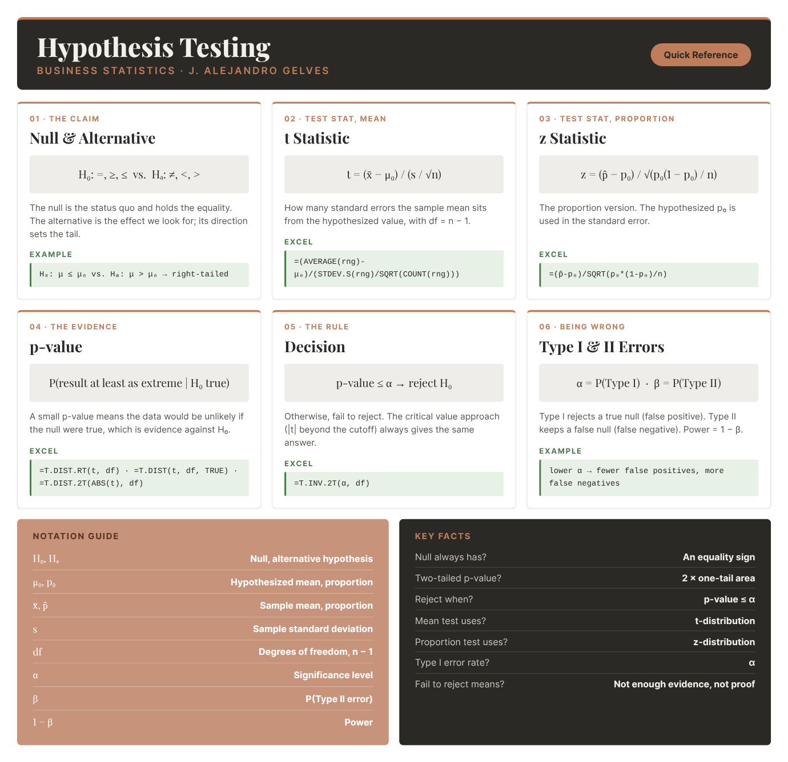

```{=html}
<style>
details {
  background-color: #F8F9FA;
  padding: 5px;
  border: 1px solid #ddd; /* Light border */
  border-radius: 5px; /* Rounded corners */
  margin: 10px 0; /* Spacing */
}

details summary {
  cursor: pointer; /* Pointer cursor for interactivity */
}
</style>
```

# Inference III

Business decisions are often framed as claims to be tested: a new supplier promises fewer defects, a marketing team believes a campaign lifted sales, an analyst suspects average spending has changed. **Hypothesis testing** is the formal procedure for deciding whether the evidence in a sample is strong enough to support such a claim, or whether the difference we see could just be sampling error. In this chapter you will learn to state null and alternative hypotheses, compute a test statistic, weigh it against a chosen level of risk, and reach a defensible conclusion, all in Excel. This is where the cycle closes: we began by wanting to learn something about the world, and hypothesis testing is the formal step of asking whether the data we collected actually support the idea we started with.

## Hypothesis Testing Intuition

Let's start with two definitions. A **hypothesis** is a claim about a population parameter, such as "the average U.S. income is \$50,000" or "more than $10\%$ of people are left-handed." **Hypothesis testing** is a method for deciding whether the evidence in a sample supports rejecting the default claim, called the null hypothesis, in favor of an alternative claim that contradicts it.

Suppose we hypothesize that the average annual income in the U.S. is \$50,000. When we take a large sample, the sample mean behaves like a normal random variable (by the Central Limit Theorem) centered at the hypothesized value. Our job is to decide whether the observed sample mean is "close enough" to \$50,000 to have plausibly come from that distribution, or "far enough" that we should doubt the claim.

::: callout-example
**Example:** We test whether the average income is \$50,000. A sample of $100$ people has a mean of \$48,000. Is \$48,000 close to \$50,000, or far? It depends entirely on the **standard error** of the sampling distribution:

- If the standard error were small (say \$1,000), then \$48,000 is two standard errors below \$50,000: strong evidence *against* the claim.
- If the standard error were large (say \$15,000), then \$48,000 is only a fraction of a standard error away, perfectly *consistent* with the claim.

Distance alone tells us nothing; distance measured in standard errors is what matters.
:::

We capture that idea with the **test statistic**, which measures how far the sample mean sits from the hypothesized value in standard-error units.

::: callout-formula
**TEST STATISTIC FOR A MEAN** $$t = \frac{\bar{x} - \mu_0}{s / \sqrt{n}}$$ with degrees of freedom $df = n - 1$, where $\bar{x}$ is the sample mean, $\mu_0$ is the hypothesized mean, $s$ is the sample standard deviation, and $n$ is the sample size.
:::

We use a $t$ statistic because the population standard deviation $\sigma$ is unknown and we replace it with $s$, just as we did for confidence intervals in Inference II. The larger the test statistic in absolute value, the stronger the evidence against the null hypothesis.

## The Null and Alternative Hypotheses

Every test starts by writing two competing hypotheses:

- The **null hypothesis** ($H_0$) is the default or status quo assumption. It is the claim we keep unless the data give us a strong reason to abandon it. The null always contains some form of equality ($=$, $\geq$, or $\leq$).
- The **alternative hypothesis** ($H_a$) contradicts the null. It uses a strict inequality ($\ne$, $>$, or $<$), and its form sets the tail of the test: $\ne$ gives a two-tailed test, $>$ a right-tailed test, and $<$ a left-tailed test.

**For a mean:**

- $H_0: \mu = \mu_0$ vs. $H_a: \mu \ne \mu_0$: two-tailed test
- $H_0: \mu \leq \mu_0$ vs. $H_a: \mu > \mu_0$: right-tailed test
- $H_0: \mu \geq \mu_0$ vs. $H_a: \mu < \mu_0$: left-tailed test

**For a proportion:**

- $H_0: p = p_0$ vs. $H_a: p \ne p_0$: two-tailed test
- $H_0: p \leq p_0$ vs. $H_a: p > p_0$: right-tailed test
- $H_0: p \geq p_0$ vs. $H_a: p < p_0$: left-tailed test

A useful rule is that the claim we want to find evidence *for* goes in the alternative. If a researcher claims that more than $10\%$ of people are left-handed, the alternative is $H_a: p > 0.10$, and the null is everything else, $H_0: p \leq 0.10$.

## Two Approaches to a Decision

Once we have a test statistic, we need a rule that tells us when it is "far enough" from the null. There are two equivalent ways to set that rule. Both always reach the same conclusion at the same significance level $\alpha$.

**The critical value (rejection region) approach.** Choose a significance level $\alpha$ and find the **critical value** from the $t$ or $z$ distribution. The critical value marks the start of the **rejection region**, the area in the tail (or tails) that holds a probability of $\alpha$. Reject $H_0$ if the test statistic falls in the rejection region.

How $\alpha$ is placed depends on the alternative. In a two-tailed test we split $\alpha$ in half and put $\alpha/2$ in each tail, since a statistic that is either too large or too small is evidence against the null. In a one-tailed test all of $\alpha$ goes in the single tail that the alternative points to. The figure below shows both cases for a $t$-distribution with $99$ degrees of freedom and $\alpha=0.05$. For the two-tailed test, the critical values are $\pm 1.98$. For the right-tailed test, the critical value is $1.66$. A left-tailed test is the mirror image of the right-tailed test, with the rejection region on the left.

```{r echo=FALSE, message=FALSE, fig.align='center', fig.height=3, fig.width=8, warning=FALSE}
library(ggplot2)
library(ggthemes)
tx <- seq(-4, 4, by = 0.01)
lab2 <- "Two-tailed test"
lab1 <- "Right-tailed test"
crit2 <- qt(0.975, 99)
crit1 <- qt(0.95, 99)
td <- rbind(
  data.frame(x = tx, y = dt(tx, 99), panel = lab2, rej = abs(tx) >= crit2),
  data.frame(x = tx, y = dt(tx, 99), panel = lab1, rej = tx >= crit1)
)
td$side <- ifelse(td$x < 0, "left", "right")
td$panel <- factor(td$panel, levels = c(lab2, lab1))
cuts <- data.frame(panel = factor(c(lab2, lab2, lab1), levels = c(lab2, lab1)),
                   x = c(-crit2, crit2, crit1))
labs_df <- data.frame(panel = factor(c(lab2, lab2, lab2, lab1, lab1), levels = c(lab2, lab1)),
                      x = c(0, -3.1, 3.1, 0, 3),
                      y = c(0.16, 0.07, 0.07, 0.16, 0.07),
                      txt = c("Fail~to~reject~H[0]", "alpha/2", "alpha/2",
                              "Fail~to~reject~H[0]", "alpha"))
cuts$txt <- sprintf("%.2f", cuts$x)
ggplot(td, aes(x, y)) +
  geom_area(data = subset(td, rej), aes(group = interaction(panel, side)),
            fill = "#3B82C4", alpha = 0.6) +
  geom_line() +
  geom_vline(data = cuts, aes(xintercept = x), linetype = "dashed") +
  geom_text(data = labs_df, aes(x, y, label = txt), parse = TRUE, size = 3.5) +
  geom_label(data = cuts, aes(x, 0.43, label = txt), size = 3, label.size = 0) +
  facet_wrap(~panel) +
  scale_y_continuous(limits = c(0, 0.45)) +
  theme_clean() +
  theme(axis.text.y = element_blank(), axis.ticks.y = element_blank()) +
  labs(x = "t", y = "")
```

**The p-value approach.** Compute the **p-value**: the probability, assuming the null is true, of observing a test statistic at least as extreme as the one obtained. Then apply the decision rule: reject $H_0$ if $\text{p-value} \leq \alpha$, and fail to reject it otherwise. A small p-value (say $0.003$) means the data would be very unlikely if the null were true, so it is evidence *against* $H_0$. A large p-value (say $0.42$) means the data are consistent with $H_0$. Like the critical value, the p-value depends on the tail of the test. For a one-tailed test it is the area in the single tail beyond the test statistic. For a two-tailed test it is twice that area, because a result just as extreme in the other direction would count as evidence too.

The table below summarizes how each approach works for two-tailed and one-tailed tests:

|   | Two-tailed ($H_a$ uses $\ne$) | One-tailed ($H_a$ uses $>$ or $<$) |
|:----------------|:-----------------------|:-------------------------------|
| **Critical value** | Split $\alpha$ into $\alpha/2$ per tail | All of $\alpha$ in one tail |
| **Reject** $H_0$ if | $\lvert\text{statistic}\rvert >$ critical value | Statistic is past the critical value, in the direction of $H_a$ |
| **p-value** | $2 \times$ (tail area) | Tail area in the direction of $H_a$ |
| **Compare the p-value to** | $\alpha$ | $\alpha$ |

Note that in both cases the p-value is compared to the full $\alpha$. The splitting of $\alpha$ only happens with critical values, because the doubling of the tail area already accounts for both tails in the p-value.

Whatever the approach, keep in mind what each decision means. Rejecting $H_0$ means the sample provides strong evidence against it. **Failing to reject** $H_0$ does not mean that the null is true. It only means that there is not enough evidence against it. This is why we say "fail to reject" rather than "accept."

::: {.content-visible when-format="html"}

:::

## Type I and Type II Errors

Because a decision is made from a sample, it can be wrong in two ways.

|                          |      $H_0$ is true      |      $H_0$ is false      |
|:-----------------------|:----------------------:|:----------------------:|
| **Reject** $H_0$         | Type I error ($\alpha$) | Correct decision (power) |
| **Fail to reject** $H_0$ |    Correct decision     | Type II error ($\beta$)  |

A **Type I error** is rejecting a true null hypothesis (a false positive). Its probability is the significance level $\alpha$, which is why $\alpha$ is also called the Type I error rate. A **Type II error** is failing to reject a false null hypothesis (a false negative). Its probability is $\beta$. The **power** of a test, $1 - \beta$, is the chance of correctly detecting a real effect. Lowering $\alpha$ guards against false positives but makes false negatives more likely, so the choice of $\alpha$ balances the two risks.

::: {.content-visible when-format="html"}

:::

## Steps to Perform a Hypothesis Test

Every hypothesis test in this book follows the same five steps:

1.  **State the hypotheses.** Write $H_0$ and $H_a$ using the forms above. The form of $H_a$ tells you whether the test is two-tailed, right-tailed, or left-tailed.

2.  **Choose the significance level** $\alpha$. This is the Type I error rate, the chance of rejecting the null when it is true. Common choices are $0.01$, $0.05$, and $0.10$.

3.  **Compute the test statistic.** For a mean, use the $t$ statistic above. For a proportion, use the $z$ statistic below. Later chapters introduce other statistics (such as the $F$ statistic), but they are used in the same way.

    ::: callout-formula
    **TEST STATISTIC FOR A PROPORTION** $$z = \frac{\hat{p} - p_0}{\sqrt{p_0(1 - p_0)/n}}$$ where $\hat{p}$ is the sample proportion, $p_0$ is the hypothesized proportion, and $n$ is the sample size. Note that the standard error is built from the hypothesized $p_0$, since we assume the null is true. The test requires $np_0 \geq 5$ and $n(1-p_0) \geq 5$.
    :::

4.  **Find the p-value (or the critical value).** Replace $t$ with $z$ for proportions:

    - Right-tailed test: $\text{p-value} = P(T \geq t)$
    - Left-tailed test: $\text{p-value} = P(T \leq t)$
    - Two-tailed test: $\text{p-value} = 2 \times P(T \geq |t|)$

5.  **Decide.** Reject $H_0$ if $\text{p-value} \leq \alpha$, or equivalently if the test statistic falls beyond the critical value. Otherwise, fail to reject $H_0$. Finish by stating the conclusion in the words of the problem.

Let's apply the five steps to two examples, one for a mean and one for a proportion.

::: callout-example
**Example 1 (mean income, two-tailed** $t$-test): A claim states that the average U.S. income is \$50,000. A sample of $n=100$ people has a standard deviation of $s=\$3{,}000$. Test the claim in two scenarios: (a) the sample mean is $\bar{x}=\$80{,}000$, and (b) the sample mean is $\bar{x}=\$50{,}300$. We use a $t$-test since $\sigma$ is unknown.

**Step 1: State the hypotheses.** $H_0: \mu = 50{,}000$ vs. $H_a: \mu \ne 50{,}000$ (two-tailed).

**Step 2: Choose the significance level.** $\alpha = 0.05$.

**Step 3: Compute the test statistic.** The standard error is $s/\sqrt{n}=3{,}000/\sqrt{100}=300$.

- Scenario (a): $t=\frac{80{,}000-50{,}000}{300}=\frac{30{,}000}{300}=100$
- Scenario (b): $t=\frac{50{,}300-50{,}000}{300}=\frac{300}{300}=1$

**Step 4: Find the critical value and the p-value.** The test is two-tailed, so $\alpha$ splits into $0.025$ per tail. With $df=99$, the critical value is $t_{0.975,\,99}=1.98$ (in Excel, `=T.INV(0.975, 99)`). The two-tailed p-value is twice the tail area (in Excel, `=T.DIST.2T(ABS(t), 99)`).

**Step 5: Decide.**

- Scenario (a): $|100|>1.98$, and the p-value is essentially $0$, which is below $0.05$. We reject $H_0$. The sample mean sits $100$ standard errors above \$50,000, which would be practically impossible if the true mean were \$50,000. There is strong evidence that the average income differs from \$50,000 (in fact, it exceeds it).
- Scenario (b): $|1|<1.98$, and the p-value is $2 \times 0.16 = 0.32$, which is above $0.05$. We fail to reject $H_0$. A sample mean one standard error away from \$50,000 is very common when the null is true, so there is not enough evidence that the average income differs from \$50,000.
:::

::: callout-example
**Example 2 (left-handers, right-tailed** $z$-test): A researcher claims that more than $10\%$ of people are left-handed. In a sample of $n=100$ people, $12\%$ are left-handed ($\hat{p}=0.12$). We use a $z$-test for a proportion, with the standard error built from the null proportion $p_0=0.10$. The conditions hold, since $np_0=10 \geq 5$ and $n(1-p_0)=90 \geq 5$.

**Step 1: State the hypotheses.** The claim goes in the alternative: $H_0: p \leq 0.10$ vs. $H_a: p > 0.10$ (right-tailed).

**Step 2: Choose the significance level.** $\alpha = 0.01$.

**Step 3: Compute the test statistic.** $$z=\frac{0.12-0.10}{\sqrt{0.10(0.90)/100}}=\frac{0.02}{0.03}=0.67$$

**Step 4: Find the critical value and the p-value.** The test is right-tailed, so all of $\alpha$ goes in the right tail. The critical value is $z_{0.99}=2.33$ (in Excel, `=NORM.S.INV(0.99)`). The p-value is the area to the right of the test statistic, $P(Z>0.67)=1-0.749=0.25$ (in Excel, `=1 - NORM.S.DIST(0.67, TRUE)`).

**Step 5: Decide.** Since $0.67<2.33$ and the p-value of $0.25$ is greater than $\alpha=0.01$, we fail to reject $H_0$. The sample proportion of $12\%$ is above $10\%$, but not by enough to rule out chance. There is insufficient evidence that more than $10\%$ of people are left-handed.
:::

## Hypothesis Testing in Excel

Excel does not have a one-click one-sample test, but every piece is a single formula. First build the test statistic from the sample, then convert it to a p-value or compare it to a critical value.

**The test statistic.** With the data in a range, the $t$ statistic for a mean is:

``` excel
=(AVERAGE(A2:A21) - 100) / (STDEV.S(A2:A21) / SQRT(COUNT(A2:A21)))
```

**p-values from the** $t$-distribution. Use `=T.DIST(t, df, TRUE)` for a left-tailed test, `=T.DIST.RT(t, df)` for a right-tailed test, and `=T.DIST.2T(ABS(t), df)` for a two-tailed test. For the critical value use `=T.INV.2T(alpha, df)` (two-tailed, which gives the same value as `=T.INV(1 - alpha/2, df)`) or `=T.INV(alpha, df)` (left-tailed; use `=T.INV(1 - alpha, df)` for a right-tailed test).

**p-values for a proportion.** The proportion test statistic is a $z$ value, so use the standard normal: `=NORM.S.DIST(z, TRUE)` for a left-tailed test, `=1 - NORM.S.DIST(z, TRUE)` for a right-tailed test, and `=2*(1 - NORM.S.DIST(ABS(z), TRUE))` for a two-tailed test. For the critical value use `=NORM.S.INV(1 - alpha)` (right-tailed), `=NORM.S.INV(alpha)` (left-tailed), or `=NORM.S.INV(1 - alpha/2)` (two-tailed).

## Excel Function Summary

Below is a list of the Excel functions used in this section:

- `=T.DIST(x, deg_freedom, TRUE)` returns the left-tail probability of the $t$-distribution.

- `=T.DIST.RT(x, deg_freedom)` returns the right-tail probability, and `=T.DIST.2T(x, deg_freedom)` returns the two-tailed probability (with a positive `x`).

- `=T.INV.2T(probability, deg_freedom)` returns the two-tailed $t$ critical value.

- `=T.INV(probability, deg_freedom)` returns the $t$ value with the given left-tail probability, used for one-tailed critical values.

- `=NORM.S.DIST(z, TRUE)` returns the standard normal cumulative probability, used for proportion tests.

- `=NORM.S.INV(probability)` returns the $z$ value with the given left-tail probability, used for $z$ critical values.

- `=AVERAGE`, `=STDEV.S`, `=COUNT`, and `=COUNTIF` build the sample mean, standard deviation, size, and counts that go into the test statistic.

## Chapter Summary Cheat Sheet

::: {.content-visible when-format="html"}

:::

::: {.content-visible when-format="pdf"}
```{r echo=FALSE, out.width="100%", fig.align='center'}

```
:::

## Check Your Understanding

Test the main ideas of the chapter before moving on to the exercises. [Pick an answer to see whether you are right and why.]{.content-visible when-format="html"}[Each answer, with an explanation, is in the answer key at the end of the book.]{.content-visible when-format="pdf"}

:::: bs-quiz
A new supplier claims its defect rate is below $4\%$. Which hypotheses test this claim?

- [ ] $H_0: p < 0.04$ vs. $H_a: p \geq 0.04$
- [ ] $H_0: p = 0.04$ vs. $H_a: p > 0.04$
- [ ] $H_0: p \leq 0.04$ vs. $H_a: p > 0.04$
- [x] $H_0: p \geq 0.04$ vs. $H_a: p < 0.04$

::: bs-quiz-why
The claim we look for evidence of goes in the alternative with a strict inequality. The null keeps the equality, so this is a left-tailed test.
:::
::::

:::: bs-quiz
A sample of $n=25$ has $\bar{x}=52$ and $s=10$. What is the test statistic for $H_0: \mu = 50$?

- [ ] $0.2$
- [x] $1$
- [ ] $5$
- [ ] $2$

::: bs-quiz-why
$t=\frac{52-50}{10/\sqrt{25}}=\frac{2}{2}=1$. The sample mean is only one standard error above the hypothesized value.
:::
::::

:::: bs-quiz
A test gives a p-value of $0.03$ at $\alpha = 0.05$. What is the decision?

- [x] Reject $H_0$
- [ ] Fail to reject $H_0$
- [ ] Accept $H_0$ as proven
- [ ] The test is inconclusive

::: bs-quiz-why
Since $0.03 \leq 0.05$, the data would be unlikely if $H_0$ were true, so we reject it.
:::
::::

:::: bs-quiz
A test gives a p-value of $0.12$ at $\alpha = 0.05$. Which conclusion is correct?

- [ ] $H_0$ has been proven true
- [ ] $H_a$ has been proven true
- [x] The sample does not provide enough evidence against $H_0$
- [ ] The probability that $H_0$ is true is $0.12$

::: bs-quiz-why
Since $0.12 > 0.05$, we fail to reject $H_0$. That is not proof that $H_0$ is true, only a lack of evidence against it.
:::
::::

:::: bs-quiz
What is a Type I error?

- [ ] Failing to reject a null hypothesis that is false
- [ ] Correctly rejecting a false null hypothesis
- [x] Rejecting a null hypothesis that is true
- [ ] Using the wrong test statistic

::: bs-quiz-why
A Type I error is a false positive, and its probability is $\alpha$. Failing to reject a false null is a Type II error.
:::
::::

:::: bs-quiz
An analyst lowers $\alpha$ from $0.05$ to $0.01$. What happens to the error risks?

- [ ] Both errors become less likely
- [x] Type I errors become less likely and Type II errors more likely
- [ ] Both errors become more likely
- [ ] Only Type I errors change

::: bs-quiz-why
A stricter $\alpha$ makes it harder to reject $H_0$. That protects against false positives but makes it easier to miss a real effect, so $\beta$ rises.
:::
::::

:::: bs-quiz
A company tests $H_0: p = 0.5$. A sample of $100$ customers gives $\hat{p}=0.56$. What is the $z$ statistic?

- [ ] $0.06$
- [ ] $0.6$
- [ ] $12$
- [x] $1.2$

::: bs-quiz-why
$z=\frac{0.56-0.5}{\sqrt{0.5(0.5)/100}}=\frac{0.06}{0.05}=1.2$. Note that $p_0$, not $\hat{p}$, goes in the standard error.
:::
::::

:::: bs-quiz
A two-tailed test of a mean gives $t=2.1$ with $df=24$. Which Excel formula returns the p-value?

- [x] `=T.DIST.2T(2.1, 24)`
- [ ] `=T.DIST.RT(2.1, 24)`
- [ ] `=T.DIST(2.1, 24, TRUE)`
- [ ] `=T.INV.2T(2.1, 24)`

::: bs-quiz-why
`T.DIST.2T` returns the area in both tails beyond $|t|$. `T.DIST.RT` gives only the right tail, and `T.INV.2T` returns a critical value, not a probability.
:::
::::

## Exercises

The following exercises will help you test your knowledge of hypothesis testing. In particular, the exercises work on:

- Stating null and alternative hypotheses.
- Testing hypotheses about a population mean.
- Testing hypotheses about a population proportion.

Try not to peek at the answers until you have formulated your own answer and double checked your work for any mistakes.

### Exercise 1 {.unnumbered}

1.  Consider the following hypothesis: $H_{0}: \mu = 50$, $H_{a}: \mu \neq 50$. A sample of $16$ observations yields a mean of $46$ and a standard deviation of $10$. Calculate the test statistic. At a $5\%$ significance level, does the population mean differ from $50$?

    <details>

    <summary>Answer</summary>

    ::: {style="padding-left: 1.5em;"}
    *The test statistic is* $-1.6$. The two-tailed p-value is $13.04\%$, which is greater than $5\%$, so we cannot reject the null. The population mean is not statistically different from $50$.

    *In Excel:*

    - `=(46 - 50) / (10 / SQRT(16))` → $-1.6$ (test statistic)
    - `=T.DIST.2T(ABS(-1.6), 15)` → $0.1304$ (two-tailed p-value)

    *The critical value `=T.INV.2T(0.05, 15)` is* $2.131$. Since $|-1.6| < 2.131$, we fail to reject the null.
    :::

    </details>

2.  Consider the following hypothesis: $H_{0}: \mu \geq 100$, $H_{a}: \mu < 100$. A sample from a normally distributed population yields the values in the table below. Test the hypothesis at a $1\%$ significance level.

    |     |     |     |     |     |     |
    |:---:|:---:|:---:|:---:|:---:|:---:|
    | 96  | 102 | 93  | 87  | 92  | 82  |

    <details>

    <summary>Answer</summary>

    ::: {style="padding-left: 1.5em;"}
    *The null hypothesis cannot be rejected: the left-tailed p-value of* $1.9\%$ is greater than the $1\%$ significance level.

    *Enter the data in a range (say `A2:A7`). In Excel:*

    - `=AVERAGE(A2:A7)` → $92$ and `=STDEV.S(A2:A7)` → $6.96$
    - `=(92 - 100) / (6.96 / SQRT(6))` → $-2.82$ (test statistic)
    - `=T.DIST(-2.82, 5, TRUE)` → $0.019$ (left-tailed p-value)
    :::

    </details>

3.  Consider the following hypothesis: $H_{0}: \mu \leq 210$, $H_{a}: \mu > 210$. A sample from a normally distributed population yields the values in the table below. Test the hypothesis at a $10\%$ significance level.

    |     |     |     |     |     |     |     |     |     |     |
    |:---:|:---:|:---:|:---:|:---:|:---:|:---:|:---:|:---:|:---:|
    | 210 | 220 | 299 | 220 | 290 | 280 | 233 | 221 | 292 | 299 |

    <details>

    <summary>Answer</summary>

    ::: {style="padding-left: 1.5em;"}
    *The null hypothesis can be rejected: the right-tailed p-value of* $0.2\%$ is less than the $10\%$ significance level.

    *Enter the data in a range (say `A2:A11`). In Excel:*

    - `=AVERAGE(A2:A11)` → $256.4$ and `=STDEV.S(A2:A11)` → $38.28$
    - `=(256.4 - 210) / (38.28 / SQRT(10))` → $3.83$ (test statistic)
    - `=T.DIST.RT(3.83, 9)` → $0.002$ (right-tailed p-value)
    :::

    </details>

### Exercise 2 {.unnumbered}

According to [nps.gov](https://www.nps.gov), the time between Old Faithful's eruptions is on average $92$ minutes. Use the **faithful** data set and a two-tailed test to determine whether this claim is true.

[ Download Data](faithful.xlsx){.btn .btn-success}

<details>

<summary>Answer</summary>

::: {style="padding-left: 1.5em;"}
*The claim that the average waiting time is* $92$ minutes can be rejected at the $10\%$, $5\%$, and $1\%$ significance levels.

*With the `waiting` column in column B (272 observations), in Excel:*

- `=AVERAGE(B2:B273)` → $70.9$ and `=STDEV.S(B2:B273)` → $13.6$
- `=(70.9 - 92) / (13.6 / SQRT(272))` → $-25.6$ (test statistic)
- `=T.DIST.2T(ABS(-25.6), 271)` → approximately $0$ (two-tailed p-value)

*The sample mean is so far below* $92$ that the p-value is essentially zero, so we reject the null at any conventional level.
:::

</details>

### Exercise 3 {.unnumbered}

1.  To test whether the population proportion differs from $0.4$, a scientist draws a random sample of $100$ observations and obtains a sample proportion of $0.48$. State the competing hypotheses. At a $5\%$ significance level, does the population proportion differ from $0.4$?

    <details>

    <summary>Answer</summary>

    ::: {style="padding-left: 1.5em;"}
    *The hypotheses are* $H_{0}: p = 0.4$ and $H_{a}: p \neq 0.4$. The two-tailed p-value is $0.102$, greater than $0.05$, so we cannot reject the null. The population proportion is not significantly different from $0.4$.

    *In Excel:*

    - `=(0.48 - 0.4) / SQRT(0.4*(1-0.4)/100)` → $1.633$ (test statistic)
    - `=2*(1 - NORM.S.DIST(1.633, TRUE))` → $0.102$ (two-tailed p-value)
    :::

    </details>

2.  A sample of $320$ observations yields $128$ successes. Test $H_{0}: p \geq 0.45$ against $H_{a}: p < 0.45$ at a $5\%$ significance level.

    <details>

    <summary>Answer</summary>

    ::: {style="padding-left: 1.5em;"}
    *The sample proportion is* $128/320 = 0.4$. The left-tailed p-value of $3.6\%$ is less than $5\%$, so we reject the null and conclude the population proportion is less than $0.45$.

    *In Excel:*

    - `=(0.4 - 0.45) / SQRT(0.45*(1-0.45)/320)` → $-1.80$ (test statistic)
    - `=NORM.S.DIST(-1.80, TRUE)` → $0.036$ (left-tailed p-value)
    :::

    </details>

3.  Determine whether more than $50\%$ of the observations in a population are below $10$, using the sample data below. Conduct the test at a $1\%$ significance level.

    |     |     |     |     |     |     |     |     |     |     |
    |:---:|:---:|:---:|:---:|:---:|:---:|:---:|:---:|:---:|:---:|
    |  8  | 12  |  5  |  9  | 14  | 11  |  9  |  3  |  7  | 12  |

    <details>

    <summary>Answer</summary>

    ::: {style="padding-left: 1.5em;"}
    *The hypotheses are* $H_{0}: p \leq 0.5$ and $H_{a}: p > 0.5$. The right-tailed p-value of $0.26$ is greater than the $1\%$ significance level, so we cannot reject the null. We therefore **cannot** conclude that more than $50\%$ of the population is below $10$.

    *Enter the data in a range (say `A2:A11`). In Excel:*

    - `=COUNTIF(A2:A11, "<10") / COUNT(A2:A11)` → $0.6$ (sample proportion)
    - `=(0.6 - 0.5) / SQRT(0.5*(1-0.5)/10)` → $0.632$ (test statistic)
    - `=1 - NORM.S.DIST(0.632, TRUE)` → $0.264$ (right-tailed p-value)
    :::

    </details>

### Exercise 4 {.unnumbered}

According to [worldatlas.com](https://www.worldatlas.com), $5\%$ of the population has hazel eyes. Use the **HairEyeColor** data set and a two-tailed test to determine whether this claim holds for the $592$ surveyed students.

[ Download Data](HairEyeColor.xlsx){.btn .btn-success}

<details>

<summary>Answer</summary>

::: {style="padding-left: 1.5em;"}
*We reject the null hypothesis: the proportion of hazel-eyed students is significantly different from* $5\%$.

*The data is tidy, with columns `Hair`, `Eye`, `Sex`, and `n`. In Excel:*

- `=SUMIF(Eye_range, "Hazel", n_range)` → $93$ and `=SUM(n_range)` → $592$, so $\hat{p} = 93/592 = 0.157$
- `=(0.157 - 0.05) / SQRT(0.05*(1-0.05)/592)` → $11.96$ (test statistic)
- `=2*(1 - NORM.S.DIST(11.96, TRUE))` → approximately $0$ (two-tailed p-value)

*The sample proportion of* $15.7\%$ is nearly $12$ standard errors above the claimed $5\%$, so we reject the null decisively.
:::

</details>
