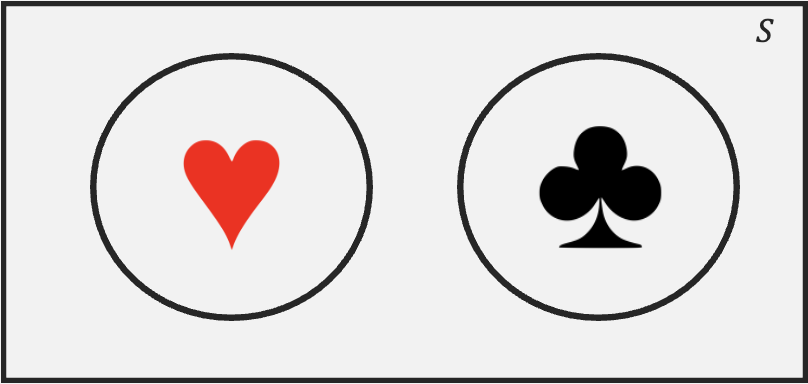
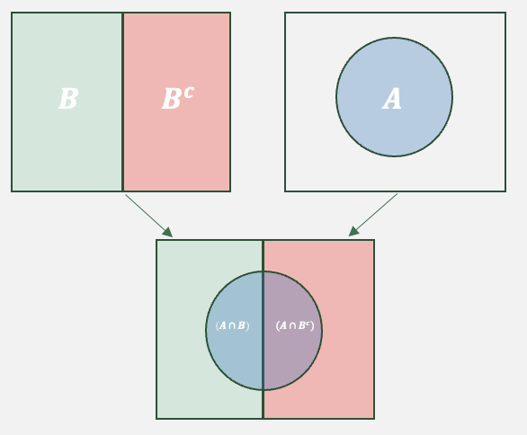
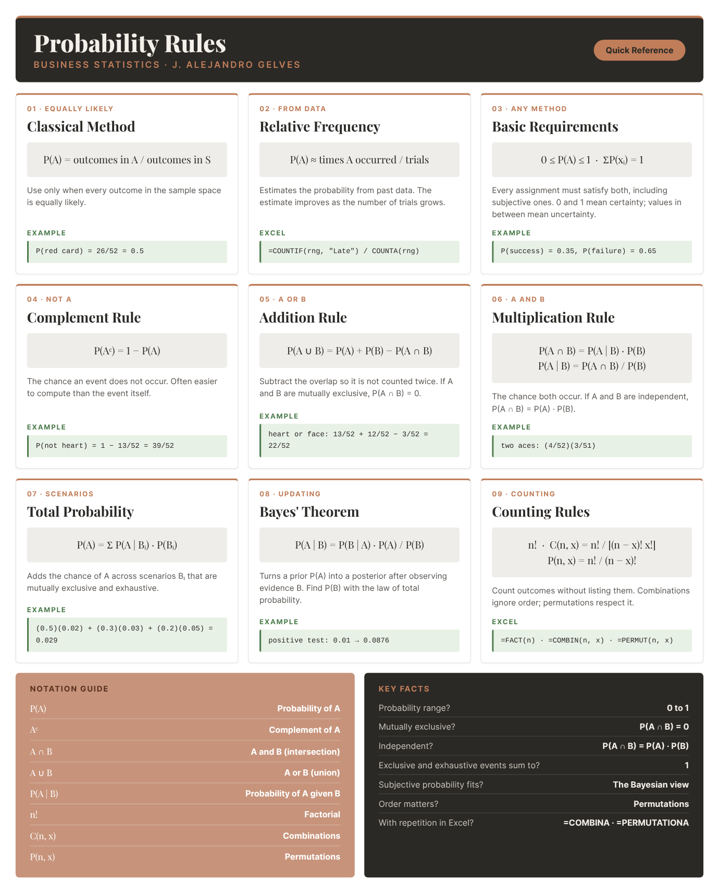

```{=html}
<style>
details {
  background-color: #F8F9FA;
  padding: 5px;
  border: 1px solid #ddd; /* Light border */
  border-radius: 5px; /* Rounded corners */
  margin: 10px 0; /* Spacing */
}

details summary {
  cursor: pointer; /* Pointer cursor for interactivity */
}
</style>
```

# Probability I

Every business decision is made under uncertainty: whether a new product will sell, whether a supplier will deliver on time, whether a stock will rise. **Probability** is the language we use to measure that uncertainty, and it marks a turning point in the book. Until now we have described data we already collected. From here we build the mathematics of uncertainty, which will later let us reason from an imperfect sample back to the population that produced it. We start with the basic ideas.

## What Is a Probability? Frequentist vs. Bayesian

Before we calculate probabilities, it helps to agree on what a probability *means*. There are two main ways to understand it.

- **Frequentist view.** A probability is the long-run proportion of times an event occurs when an experiment is repeated many times under the same conditions. Saying a product has a $2\%$ return rate means that, over many sales, about $2$ in every $100$ items come back. In this view, probabilities only make sense for events that can be repeated.

- **Bayesian view.** A probability is a degree of belief about how likely an event is. It is *subjective* in the sense that it reflects a reasoned judgment based on the evidence and experience available, not a random guess, and it is updated as new data arrive. This lets us put a probability on one-time events, such as the chance that a particular product launch succeeds. A frequentist would not assign such a probability, because the launch cannot be repeated.

The two views disagree about what a probability *is*, but they follow the same rules (the Addition Rule, the Multiplication Rule, and Bayes' Theorem), so the calculations in this book work the same way under either one.

::: callout-example
**Example:** A company estimates the return rate of an existing product from the share of past sales that were returned. That is a frequentist probability. For a brand-new product with no sales history, managers instead assign a probability of success from market research and experience, and revise it as early sales come in. That is a Bayesian probability.
:::

## Experiments and Sets

The following concepts form the foundation of probability theory. They provide a structure that is useful when analyzing uncertainty and randomness.

- An **experiment** is a process that leads to one of several outcomes. *Ex: Tossing a Die, Tossing a Coin, Drawing a Card, etc.*

- An **outcome** is the result of an experiment. *Ex: A coin landing on heads, drawing the ace of spades.*

- The **sample space** $(S)$ of an experiment contains all possible outcomes of the experiment. *Ex:* $S=\{1,2,3,4,5,6\}$ is the sample space for tossing a die.

- An **event** is a subset of the sample space. *Ex:* $A=\{2,4,6\}$ is the event of tossing an even number when rolling a die. $B=\{1A,1D,1S,1H\}$ is the event of drawing an ace from a deck of cards.

## Basic Probability Concepts

A **probability** is a numerical value that measures the likelihood that an event occurs. There are three common ways to assign one.

**Classical method.** When every outcome in the sample space is equally likely (a fair die, a well-shuffled deck of cards), the probability of an event is the share of outcomes that belong to it:

::: callout-formula
**CLASSICAL PROBABILITY** $$P(A)=\frac{Number\ of\ outcomes\ in\ A}{Number\ of\ outcomes\ in\ Sample \ Space}$$ This formula only applies when all outcomes are equally likely.
:::

::: callout-example
**Example:** Draw one card at random from a standard deck of $52$ cards. Every card is equally likely, so we can use the classical method. Let $A$ be the event of drawing a red card. There are $26$ red cards, so

$$P(A) = \frac{\text{Number of red cards}}{\text{Total number of cards}} = \frac{26}{52} = 0.5$$
:::

**Relative frequency (empirical) method.** When outcomes are not equally likely, we estimate the probability from data: the proportion of times the event happened over many repetitions of the experiment. This is the frequentist view put into practice, and the estimate improves as the number of trials grows.

::: callout-formula
**RELATIVE FREQUENCY PROBABILITY** $$P(A)\approx\frac{Number\ of\ times\ A\ occurred}{Number\ of\ trials}$$
:::

::: callout-example
**Example:** A distributor wants to know how likely it is that an order arrives late. Deliveries are not equally likely to be on time, late, or damaged, so the classical method does not apply. Instead, the distributor looks at its records for the last $600$ orders:

| Delivery outcome | Number of orders | Relative frequency |
|:----------------:|:----------------:|:------------------:|
|     On time      |       552        |  $552/600 = 0.92$  |
|       Late       |        18        |  $18/600 = 0.03$   |
|     Damaged      |        30        |  $30/600 = 0.05$   |
|      Total       |       600        |        $1$         |

The estimated probability that the next order arrives late is $P(\text{late}) \approx 18/600 = 0.03$. It is an estimate: with records from $6{,}000$ orders instead of $600$, the distributor could pin it down more precisely. In Excel, with the outcomes in column A, `=COUNTIF(A2:A601, "Late")/COUNTA(A2:A601)` returns $0.03$.
:::

**Subjective method.** When there is no repeatable experiment and little or no data, a probability is assigned by reasoned judgment: an analyst or expert weighs the available evidence and experience. Subjective probabilities match the Bayesian view; they are not frequentist probabilities, because the event cannot be repeated to check them.

::: callout-example
**Example:** A company is about to launch a new kind of product, so there is no sales history to count. The product manager still needs a probability that the launch succeeds. She weighs the evidence she has: a customer survey in which $40\%$ of respondents said they would buy, the fact that two similar products from competitors succeeded while one failed, and her own experience with past launches. Putting this together, she assigns

$$P(\text{success}) = 0.35 \qquad P(\text{failure}) = 0.65$$

Another manager, weighing the same evidence differently, might say $0.30$ or $0.40$, and that is acceptable: subjective probabilities can differ from person to person, but they must still follow the basic requirements below (here, $0.35 + 0.65 = 1$). They should also change with new evidence. If a test launch in two cities sells better than expected, she might revise $P(\text{success})$ up to $0.55$.
:::

## Basic Requirements for Assigning Probabilities

Whichever method we use to assign probabilities (classical, relative frequency, or subjective), the result must satisfy two basic requirements. Any set of numbers that breaks either one is not a valid set of probabilities.

::: callout-formula
**BASIC REQUIREMENTS FOR ASSIGNING PROBABILITIES**

1.  Every probability is between $0$ and $1$: $$0 \leq P(A) \leq 1$$
2.  The probabilities of all the outcomes in the sample space add up to $1$: $$\sum P(x_i) = 1$$ where $x_i$ is outcome $i$ of the experiment.
:::

### Requirement 1: From Certainty to Uncertainty {.unnumbered}

The two ends of the scale represent **certainty**. A probability of $0$ means the event is impossible, and a probability of $1$ means it is certain to happen. In both cases there is nothing left to guess.

Everything in between is **uncertainty**. The closer a probability is to $0.5$, the less we know: at $0.5$ the event is as likely to happen as not, like a coin flip. A probability of $0.95$ or $0.05$ still leaves some doubt, but we can act with a lot of confidence.

**Information moves probabilities toward the extremes.** As we learn more, we can say with greater confidence whether something will or will not happen. This is why businesses collect data: good information reduces uncertainty.

```{=html}
<figure class="bs-probscale" aria-label="Probability scale from 0 (impossible) to 1 (certain), with the loan example: 0.02 with excellent credit history, 0.10 with no information, 0.70 after three missed payments">
<svg viewBox="0 0 700 150" width="100%" role="img">
  <defs><linearGradient id="bsScaleGrad" x1="0" x2="1">
    <stop offset="0" stop-color="var(--bs-part)"/><stop offset="0.5" stop-color="var(--bs-paper-3)"/><stop offset="1" stop-color="var(--bs-part)"/>
  </linearGradient></defs>
  <rect x="20" y="66" width="660" height="12" rx="6" fill="url(#bsScaleGrad)"/>
  <g font-family="Inter, sans-serif" fill="var(--bs-ink)">
    <line x1="86" y1="40" x2="86" y2="66" stroke="var(--bs-ink)" stroke-width="2"/>
    <text x="86" y="18" font-size="13" font-weight="700" text-anchor="middle">0.10</text>
    <text x="86" y="34" font-size="11.5" fill="var(--bs-ink-2)" text-anchor="middle">no information yet</text>
    <line x1="482" y1="40" x2="482" y2="66" stroke="var(--bs-ink)" stroke-width="2"/>
    <text x="482" y="18" font-size="13" font-weight="700" text-anchor="middle">0.70</text>
    <text x="482" y="34" font-size="11.5" fill="var(--bs-ink-2)" text-anchor="middle">missed three payments</text>
    <line x1="33" y1="78" x2="33" y2="100" stroke="var(--bs-ink)" stroke-width="2"/>
    <text x="38" y="114" font-size="13" font-weight="700">0.02</text>
    <text x="74" y="114" font-size="11.5" fill="var(--bs-ink-2)">excellent credit history</text>
    <text x="20" y="142" font-size="12" font-weight="600">0 · impossible</text>
    <text x="350" y="142" font-size="12" font-weight="600" text-anchor="middle">0.5 · most uncertain</text>
    <text x="680" y="142" font-size="12" font-weight="600" text-anchor="end">1 · certain</text>
  </g>
</svg>
</figure>
```

::: callout-example
**Example:** A bank is deciding whether to approve a loan. Before it knows anything about the applicant, it uses the default rate for all borrowers, so $P(\text{default}) = 0.10$. If the applicant has an excellent credit history, the estimate drops to about $0.02$, close to certain the loan will be repaid. If instead the applicant has missed three payments on other loans, it rises to about $0.70$, much closer to certain default. In each case, new information pushed the probability away from the uncertain middle and toward one of the extremes. Once the loan is fully repaid, the uncertainty is gone: $P(\text{default}) = 0$.
:::

### Requirement 2: The Probabilities Add Up to 1 {.unnumbered}

When we run an experiment, one of its outcomes must occur. The probability that *something* in the sample space happens is therefore $1$, and that total has to be shared among the outcomes. If the probabilities added up to less than $1$, we would be leaving room for nothing to happen; if they added up to more, we would be counting some possibility more than once.

The outcomes of an experiment have two properties that make this work:

- They are **mutually exclusive**: they do not overlap, so if one happens the others cannot.
- They are **exhaustive**: together they cover every possibility in the sample space, so one of them must happen.

The same logic applies to any list of events, not just individual outcomes. Whenever a list of events is both mutually exclusive and exhaustive, exactly one of them will occur, so their probabilities add up to $1$: something must happen, and only one thing can.

::: callout-example
**Example:** Consider the four suits in a deck of cards (*hearts, diamonds, clubs, spades*). They are mutually exclusive, because a card cannot belong to two suits, and exhaustive, because every card belongs to one of them. Their probabilities add up to $1$:

$$P(\text{hearts}) + P(\text{diamonds}) + P(\text{clubs}) + P(\text{spades}) = 4 \times \frac{13}{52} = 1$$

Both conditions matter. Hearts and spades alone are mutually exclusive but not exhaustive, so $P(\text{hearts}) + P(\text{spades}) = 0.5$ falls short of $1$. Hearts and red cards are not mutually exclusive, since every heart is also red, so adding $P(\text{hearts}) + P(\text{red}) = 0.25 + 0.5 = 0.75$ counts the hearts twice.
:::

## Venn Diagram

A Venn diagram is a visual representation of sets and their relationships. It consists of overlapping circles, each representing a set. Below is an example:

```{r echo=FALSE, out.width="75%", fig.align='center'}

```

The rectangle enclosing the circles represents the sample set (i.e., the 52 playing cards). Each circle represents a set or event The heart circle contains all 13 hearts; the same holds for the clubs circle. The area outside the circle that has hearts represents its complement, meaning elements that are clubs, spades, or diamonds. Since the two sets do not overlap, they are mutually exclusive (i.e., if a card is a heart, it can't be a spade). The total area covered by both sets represents the **union** denoted by $\cup$. This is the set that contains all elements that belong to at least one of the sets. Formally, we would represent this set as $(Hearts \cup Spades)$.

```{r echo=FALSE, out.width="75%", fig.align='center'}

```

The overlapping region of two sets contains elements that belong to both sets. This region is called the **intersection**. The intersection contains elements that are Hearts and Jacks (i.e., the jack of hearts). Formally, we denote the intersection by $(Hearts \cap Jacks)$.

## Probability Rules

Probability rules help us quantify uncertainty, avoid cognitive biases, and make rational predictions based on available data. These rules allow us to make reliable decisions. Below we introduce some useful rules.

### Complement Rule {.unnumbered}

The **Complement Rule** states that:

::: callout-formula
**THE COMPLEMENT RULE** $$P(A^c)=1-P(A)$$ where $A^c$ is the complement of $A$.
:::

This rule is useful when calculating probabilities for complex scenarios, where finding the probability of the complement is easier than computing the event itself.

::: callout-example
**Example:** The probability of drawing a spade, diamond or clubs can be estimated by just calculating the probability of drawing a heart. Since the probability of drawing a heart is $P(Heart)=\frac{13}{52}$, then using the complement rule, $P(Not \text{Heart})=1-\frac{13}{52}=\frac{39}{52}$.
:::

### De Morgan's Laws {.unnumbered}

**De Morgan's Laws** relate the complement of a union to the complement of an intersection. They are handy for rewriting a complicated event as an easier-to-compute one.

::: callout-formula
**DE MORGAN'S LAWS** $$(A \cup B)^c = A^c \cap B^c \qquad\qquad (A \cap B)^c = A^c \cup B^c$$ The complement of a union is the intersection of the complements, and the complement of an intersection is the union of the complements.
:::

::: callout-example
**Example:** Roll a die with $A=\{1,2,3\}$ and $B=\{2,4,6\}$. Their union is $A \cup B=\{1,2,3,4,6\}$, so the complement is $(A \cup B)^c=\{5\}$. De Morgan's Law gives the same answer from the complements: $A^c \cap B^c=\{4,5,6\} \cap \{1,3,5\}=\{5\}$.
:::

### Addition Rule {.unnumbered}

The **Addition Rule** states:

::: callout-formula
**THE ADDITION RULE** $$P(A \cup B)=P(A)+P(B)-P(A \cap B)$$ where $\cap$ is intersection and $\cup$ is union.
:::

This formula prevents double-counting when events overlap by including the intersection of events.

::: callout-example
**Example:** Let's calculate the probability of drawing either a heart or a face card. If we let event $A$ be drawing a heart, and event $B$ be drawing a face card, the probability is given by: $$P(A \cup B)=\frac{13}{52}+\frac{12}{52}-\frac{3}{52}=\frac{22}{52}$$
:::

### Multiplication Rule {.unnumbered}

The **Multiplication Rule** states:

::: callout-formula
**THE MULTIPLICATION RULE** $$P(A \cap B)= P(A|B)P(B)$$ where $P(A|B)$ is the conditional probability.
:::

**Conditional probability** measures the likelihood of an event occurring given that another event has already happened. If we reorganize the formula above we can get:

::: callout-formula
**CONDITIONAL PROBABILITY** $$P(A|B)=\frac{P(A \cap B)}{P(B)}$$
:::

Note that this formula focuses on cases where Event B has already occurred. We can then find the fraction of the cases where Event A also happens.

::: callout-example
**Example:** Suppose we randomly draw two cards from a standard deck of 52 cards, without replacement. The probability that both cards are aces is given by: $$P(Ace_1 \cap Ace_2)=P(Ace_1) \times P(Ace_2|Ace_1)= \frac {4}{52} \times \frac{3}{51}$$
:::

Lastly, if events $A$ and $B$ are independent, we can simplify the multiplication rule to:

::: callout-formula
**INDEPENDENCE** $$P(A \cap B)= P(A)P(B)$$
:::

Hence, we can define independence as: events $A$ and $B$ are independent if the occurrence (or non occurrence) of one does not affect the probability of the other occurring.

::: callout-example
**Example:** Suppose we randomly draw a card from a standard deck, replace it, and then draw another card. The probability of drawing a heart in the first draw is $13/52$, and the probability of drawing a spade in the second draw is also $13/52$.
:::

::: callout-example
**Example:** Suppose that the weather is sunny; this has no effect on the outcome of a lottery. Hence, the weather and lottery outcomes are independent.
:::

### Law of Total Probability {.unnumbered}

The **Law of Total Probability** states:

::: callout-formula
**LAW OF TOTAL PROBABILITY** $$P(A)=P(A \cap B)+P(A\cap B^c)$$ which, using the multiplication rule, can also be written as $$P(A)=P(A|B)P(B)+P(A|B^c)P(B^c)$$
:::

The formula mainly states that if an event $A$ can occur in multiple mutually exclusive scenarios (or conditions), then the total probability of $A$ is the sum of its probabilities under each scenario, weighted by how often those scenarios occur. The Venn diagram helps us visualize the law of total probability.

```{r echo=FALSE, out.width="75%", fig.align='center'}

```

The image shows how event $A$ can occur. Essentially, when $B$ occurs $A$ is possible in the left semicircle. When $B^c$, then $A$ is possible in the right semicircle. The addition of both semicircles, complete set $A$.

::: callout-example
**Example:** Consider the sets face cards and hearts. The entire set of hearts can be completed by taking face cards that are hearts, and non face cards (the complement of face cards) that are hearts.
:::

The same idea extends to **any** number of scenarios. If $B_1, B_2, \dots, B_k$ are mutually exclusive and together cover the whole sample space, the total probability of $A$ is found by summing across all of them:

::: callout-formula
**LAW OF TOTAL PROBABILITY (Several Events)** $$P(A)=\sum_{i=1}^{k} P(A \cap B_i)=\sum_{i=1}^{k} P(A|B_i)\,P(B_i)$$ where the events $B_1, B_2, \dots, B_k$ are mutually exclusive and exhaustive (they partition the sample space).
:::

::: callout-example
**Example:** A factory makes a part on three machines. Machine 1 produces $50\%$ of the parts with a $2\%$ defect rate, Machine 2 produces $30\%$ with a $3\%$ defect rate, and Machine 3 produces $20\%$ with a $5\%$ defect rate. The overall probability that a randomly chosen part is defective is $$P(D)=(0.50)(0.02)+(0.30)(0.03)+(0.20)(0.05)=0.029$$ so about $2.9\%$ of all parts are defective.
:::

### Bayes' Theorem {.unnumbered}

**Bayes' Theorem** states:

::: callout-formula
**BAYES' THEOREM** $$P(A|B)= \frac{P(B|A)P(A)}{P(B)}$$
:::

In essence, Bayes' theorem is a way of updating probabilities in light of new evidence. The theorem tells us that the probability of an event A given that we have observed some evidence is equal to the prior probability ($P(A)$) times a factor that measures the informativeness of the observed evidence $P(B|A)/P(B)$.

::: callout-example
**Example:** Assume that a rare form of cancer affects 1% of the population. That is, 1 out of 100 people will likely be affected by it. There is a test for the cancer, but it is imperfect. In particular, if you don't have cancer, the test says that you do 10% of the time (false positive rate). Also, if you do have cancer, it will tell you that you don't have it 5% of the time. Let's say you get tested, and your doctor calls you and says you have tested positive. How likely is it that you have this type of cancer?

We can use the Law of Total Probability and Bayes' theorem to answer this question. Let's first identify what we want to estimate. Since we need to figure out the likelihood of having cancer, given that we tested positive, we are looking for $P(C|+)$. Now, we can set up Bayes' rule to see what additional information we need to find our desired value. Bayes' rule states:

$$P(C|+)= \frac{P(+|C)P(C)}{P(+)}$$ Since the problem does not provide the $P(+)$ we must estimate it with the Law of Total Probability, mainly:

$$P(+)=P(+|C)P(C)+P(+|NC)P(NC)=(0.95 \times 0.01)+(0.1 \times 0.99)=0.1085$$ We can now use this probability to find our new belief that we have cancer:

$$P(C|+)= \frac{(0.95 \times 0.01) }{0.1085}=0.0876$$ In conclusion, if we before thought we had a $1\%$ chance of having the rare form of cancer, once we were told that we tested positive, we should update our belief to about $8.76\%$.
:::

## Contingency Tables

A **contingency table** (or cross-tabulation) summarizes the relationship between two or more events (or variables). It is particularly helpful when analyzing frequencies of events and their relationship to other events.

The contingency table below shows the frequency of event A and B occurring/not occurring.

::: bs-crosstab
|       | $B$ | $B^c$ | Total |
|:-----:|:---:|:-----:|:-----:|
|  $A$  | 26  |  34   |  60   |
| $A^c$ | 14  |  26   |  40   |
| Total | 40  |  60   |  100  |

: Contingency table: frequencies of A and B (n = 100)
:::

We can see that event A occurs 60 times and that event B occurs 40 times. Most importantly, we can also see how the two events are not mutually exclusive, since A and B occur 26 times. The table can be easily translated to probabilities, by dividing each entry by the total amount of outcomes (i.e., 100). We call the table that includes probabilities the **joint probability table**.

::: bs-crosstab
|       | $B$  | $B^c$ | Total |
|:-----:|:----:|:-----:|:-----:|
|  $A$  | 0.26 | 0.34  | 0.60  |
| $A^c$ | 0.14 | 0.26  | 0.40  |
| Total | 0.40 | 0.60  |   1   |

: Joint probability table: joint probabilities inside, marginal probabilities in the Total row and column
:::

In the middle of the table we have the joint probabilities or intersections of events (i.e., $A \cap B$, $A \cap B^c$, etc.). The values in the totals columns or rows are the probabilities of each event happening (i.e., $P(A)$, $P(B^c)$, etc.). We call these probabilities **marginal probabilities** since they reside at the margin of the table.

## Counting Rules

Counting rules are useful in probability as they allow us to determine the number of ways events can occur without listing out every possibility. Essentially, they facilitate the enumeration of possible outcomes for large sets.

### The Fundamental Counting Principle {.unnumbered}

The most basic counting rule, and the one all the others build on, is the **Fundamental Counting Principle** (also called the Multiplication Principle). It states that if a task is completed in separate stages, the total number of ways to complete it is the product of the number of choices available at each stage.

::: callout-formula
**THE FUNDAMENTAL COUNTING PRINCIPLE** $$m_1 \times m_2 \times \dots \times m_k$$ where $m_i$ is the number of choices at stage $i$, for a task made up of $k$ stages.
:::

::: callout-example
**Example:** A restaurant offers $3$ appetizers, $4$ entrées, and $2$ desserts. The number of different three-course meals is $3 \times 4 \times 2 = 24$.
:::

### Factorial {.unnumbered}

To illustrate the factorial, consider the number of ways that we can organize a group of three people (Ann, Beth, Charlie). The enumeration of all the possible orderings in this case is not that tedious and it can be shown in a table:

| Ordering |        Order         |
|:--------:|:--------------------:|
|    1     | (Ann, Beth, Charlie) |
|    2     | (Ann, Charlie, Beth) |
|    3     | (Beth, Ann, Charlie) |
|    4     | (Beth, Charlie, Ann) |
|    5     | (Charlie, Ann, Beth) |
|    6     | (Charlie, Beth, Ann) |

The table shows that there are six possible ways to organize a group of three people. This is really just the Fundamental Counting Principle at work: there are $3$ choices for the first spot, then $2$ remaining choices for the second, and only $1$ left for the third, giving $3 \times 2 \times 1 = 6$. The **Factorial** captures exactly this pattern: it counts how many ways a group of $N$ objects can be organized. Formally, we write:

::: callout-formula
**THE FACTORIAL** $$Factorial=N!$$ where the operator $!$ means to take the product of all positive integers from $N$ down to $1$. Note that $0!$ is equal to one.
:::

If we then try to find in how many ways we can organize a group of three people, we can avoid enumeration by calculating $3!=3 \times 2 \times 1=6$.

::: callout-example
**Example:** Let's assume that a manager has locked down the first five batters in a given game, but is undecided on the batting order. The number of ways that he can organize the five batters is given by $5!=5 \times 4 \times 3 \times 2 \times 1=120$.
:::

### Combinations {.unnumbered}

The **Combination** function counts the number of ways to choose $x$ objects from a total of $n$ objects. The order in which the $x$ objects are listed does not matter. If repetition is not allowed use:

::: callout-formula
**COMBINATIONS (No Repetition)** $$C(n, x)= \frac{n!}{(n-x)!x!}$$
:::

::: callout-example
**Example:** Let's imagine visiting the Mexican restaurant Chipotle. We are choosing a bowl for lunch and we can choose from the following items: beans, chicken, rice, pico, guac, and beef. If we are only allowed to select four items out of the six, in how many ways can we construct a bowl? Below we use the combination formula to show that there are $15$ possible bowls. $$C(6, 4)= \frac{6!}{(6-4)!4!}=\frac{6 \times 5}{2}=15$$
:::

There are situations when we wish to count all possible combinations inclusive of repetition of elements. If repetition is allowed we use the following formula:

::: callout-formula
**COMBINATIONS (With Repetition)** $$C(n+x-1,x)=\frac{(x+n-1)!}{(n-1)!x!}$$
:::

::: callout-example
**Example:** Imagine you visit the ice cream store. You want a three scoop dish of ice cream. In how many ways can you choose your dish if the flavors are vanilla, chocolate, smores, brownie, and chips? Below we use the combination formula with repetition to show that the answer is $35$. $$C(7,3)=\frac{(5+3-1)!}{(5-1)!3!}= 7 \times 5=35$$
:::

### Permutations {.unnumbered}

The **Permutation** function also counts the number of ways to choose $x$ objects from a total of $n$ objects. However, the order in which the $x$ objects are listed does matter. Note that since order matters, the permutation will always count at least as many outcomes as the combination. When repetition is not allowed, permutations can be counted by:

::: callout-formula
**PERMUTATIONS (No Repetition)** $$P(n,x)= \frac{n!}{(n-x)!}$$
:::

::: callout-example
**Example:** The Olympic medal finals for the 100 meters sprint has eight runners competing for three medals. How many medal podiums are possible? There are a total of $336$. Below you can see the calculation. $$P(8,3)= \frac{8!}{5!}= 8 \times 7 \times 6=336$$
:::

As with combinations, there might be situations where we wish to count when repetition is allowed. If this is the case, use:

::: callout-formula
**PERMUTATIONS (With Repetition)** $$P(n,x)=n^x$$
:::

::: callout-example
**Example:** You are trying to guess the code of a lock with three dials. Since each dial has 10 numbers to choose from, there are $10^3=1000$ possible permutations.
:::

## Probability in Excel

Excel has a collection of functions that make counting and probability calculations straightforward.

**Contingency tables:** Use a **PivotTable** (`Insert → PivotTable`) to build a contingency table from raw data. Place one variable in the Rows area, the other in the Columns area, and any field in the Values area as a count. To turn the counts into a joint probability table, use `Value Field Settings → Show Values As → % of Grand Total`. You can also count a specific combination of conditions directly with `=COUNTIFS(range1, criteria1, range2, criteria2)`.

**Factorial:** The `=FACT(number)` function returns the factorial of a number. For example, `=FACT(5)` returns $120$.

**Combinations:** The `=COMBIN(number, number_chosen)` function counts the number of combinations without repetition. Use `=COMBINA(number, number_chosen)` when repetition is allowed.

**Permutations:** The `=PERMUT(number, number_chosen)` function counts the number of permutations without repetition. Use `=PERMUTATIONA(number, number_chosen)` when repetition is allowed.

## Excel Function Summary

Below is a list of the Excel functions used in this section:

- `=COUNTIFS(range1, criteria1, ...)` counts the observations that satisfy several conditions at once, useful for building contingency tables.

- `=FACT(number)` returns the factorial of a number.

- `=COMBIN(number, number_chosen)` returns the number of combinations without repetition; `=COMBINA(number, number_chosen)` allows repetition.

- `=PERMUT(number, number_chosen)` returns the number of permutations without repetition; `=PERMUTATIONA(number, number_chosen)` allows repetition.

## Chapter Summary Cheat Sheet

::: {.content-visible when-format="html"}

:::

::: {.content-visible when-format="pdf"}
```{r echo=FALSE, out.width="100%", fig.align='center'}

```
:::

## Check Your Understanding

Test the main ideas of the chapter before moving on to the exercises. [Pick an answer to see whether you are right and why.]{.content-visible when-format="html"}[Each answer, with an explanation, is in the answer key at the end of the book.]{.content-visible when-format="pdf"}

:::: bs-quiz
A distributor reviews its last $600$ orders and finds that $18$ arrived late. It uses $18/600=0.03$ as the probability that the next order is late. Which method is this?

- [x] Relative frequency (empirical)
- [ ] Classical
- [ ] Subjective
- [ ] Bayes' theorem

::: bs-quiz-why
The probability is estimated from how often the event happened in past trials. The classical method needs equally likely outcomes, which deliveries are not.
:::
::::

:::: bs-quiz
An experiment has three outcomes. Which of these is **not** a valid assignment of probabilities?

- [ ] $0.2$, $0.3$, $0.5$
- [ ] $0.6$, $0.4$, $0$
- [x] $0.5$, $0.4$, $0.2$
- [ ] $1/3$, $1/3$, $1/3$

::: bs-quiz-why
The probabilities of all outcomes must add up to $1$, and $0.5+0.4+0.2=1.1$. A probability of $0$ is allowed; it means the outcome is impossible.
:::
::::

:::: bs-quiz
$P(A)=0.3$, $P(B)=0.5$, and $P(A \cap B)=0.1$. What is $P(A \cup B)$?

- [ ] $0.8$
- [x] $0.7$
- [ ] $0.9$
- [ ] $0.15$

::: bs-quiz-why
By the addition rule, $P(A \cup B)=0.3+0.5-0.1=0.7$. Subtracting the overlap keeps it from being counted twice.
:::
::::

:::: bs-quiz
Events $A$ and $B$ are independent, with $P(A)=0.4$ and $P(B)=0.5$. What is $P(A \cap B)$?

- [ ] $0.90$
- [ ] $0.10$
- [ ] $0$
- [x] $0.20$

::: bs-quiz-why
For independent events, $P(A \cap B)=P(A)P(B)=0.4 \times 0.5=0.20$. A value of $0$ would describe mutually exclusive events, which cannot both happen.
:::
::::

:::: bs-quiz
Events $A$ and $B$ are mutually exclusive, with $P(A)=0.3$ and $P(B)=0.4$. What is $P(A \cap B)$?

- [ ] $0.12$
- [ ] $0.70$
- [x] $0$
- [ ] $0.10$

::: bs-quiz-why
Mutually exclusive events cannot happen together, so their intersection has probability $0$. The value $0.12$ would apply only if they were independent.
:::
::::

:::: bs-quiz
Use the chapter's joint probability table: $P(A \cap B)=0.26$ and $P(B)=0.40$. What is $P(A|B)$?

- [x] $0.65$
- [ ] $0.26$
- [ ] $0.43$
- [ ] $0.60$

::: bs-quiz-why
$P(A|B)=\frac{P(A \cap B)}{P(B)}=\frac{0.26}{0.40}=0.65$. Knowing that $B$ occurred restricts us to the $B$ column of the table.
:::
::::

:::: bs-quiz
Of a store's transactions, $2\%$ are fraudulent. A screening system flags $90\%$ of fraudulent transactions and $5\%$ of legitimate ones. If a transaction is flagged, about how likely is it to be fraudulent?

- [ ] About $0.90$
- [ ] About $0.02$
- [ ] About $0.07$
- [x] About $0.27$

::: bs-quiz-why
$P(\text{flag})=0.90(0.02)+0.05(0.98)=0.067$, by the law of total probability. Then $P(\text{fraud}|\text{flag})=\frac{0.90(0.02)}{0.067}\approx0.27$. Most flags are false alarms because fraud is rare.
:::
::::

:::: bs-quiz
A manager picks $3$ of her $8$ employees to form a committee. The order of selection does not matter. How many different committees are possible?

- [ ] $336$
- [x] $56$
- [ ] $24$
- [ ] $512$

::: bs-quiz-why
Order does not matter, so use combinations: $C(8,3)=\frac{8!}{5!\,3!}=56$. The value $336$ is $P(8,3)$, which counts ordered selections.
:::
::::

## Exercises

The following exercises will help you practice some probability concepts and formulas. In particular, the exercises work on:

- Calculating simple probabilities.

- Applying probability rules.

- Using counting rules.

Answers are provided below. Try not to peak until you have a formulated your own answer and double checked your work for any mistakes.

### Exercise 1 {.unnumbered}

For the following exercises, make your calculations by hand and verify results with a calculator or Excel.

1.  A sample space $S$ yields five equally likely events, $A$, $B$, $C$, $D$, and $E$. Find $P(D)$, $P(B^c)$, and $P(A \cup C \cup E)$.

<details>

<summary>Answer</summary>

- $P(D)=1/5=0.2$ since all events are equally likely.
- $P(B^c)=4/5=0.8$
- $P(A \cup C \cup E)=P(A + C + E)=3/5=0.6$.

</details>

2.  Consider the roll of a die. Define $A$ as {1,2,3}, $B$ as {1,2,3,5,6}, $C$ as {4,6}, and $D$ as {4,5,6}. Are the events $A$ and $B$ mutually exclusive, exhaustive, both or none? What about events $A$ and $D$?

<details>

<summary>Answer</summary>

- *Events* $A$ and $B$ are not mutually exclusive since they share some of the same elements.
- *The events are not exhaustive since the union of both doesn't create the sample space.*

</details>

3.  A recent study suggests that $33.1$% of the adult U.S. population is overweight and $35.7$% obese. What is the probability that a randomly selected adult in the U.S. is either obese or overweight? Are the events mutually exclusive and exhaustive? What is the probability that their weight is normal?

<details>

<summary>Answer</summary>

- *The probability is* $68.8$%.
- *The events are mutually exclusive. If someone is classified as obese, the person is not classified again as overweight.*
- *The events are not exhaustive since there are people in the U.S. that have a normal weight.*
- *The probability that the person drawn has normal weight is* $31.2$%.

</details>

### Exercise 2 {.unnumbered}

For the following exercises, make your calculations by hand and verify results with a calculator or Excel.

1.  Let $P(A)=0.65$, $P(B)=0.3$, and $P(A|B)=0.45$. Calculate $P(A \cap B)$, $P(A \cup B)$, and $P(B|A)$.

<details>

<summary>Answer</summary>

*From the multiplication rule,* $$P(A|B)*P(B)=P(A \cap B)$$

*substituting values yields:* $$P(A \cap B)=0.45*0.3=0.135$$ *From the addition rule,* $$P(A \cup B)=P(A)+P(B)-P(A \cap B)$$ *substituting yields:* $$P(A \cup B)=0.65+0.3-0.135=0.815$$ *From the multiplication rule once again,* $$P(B|A)=\frac{P(A \cap B)}{P(A)}$$ *substituting values yields,* $$P(B|A)=0.135/0.65=0.2076923$$

</details>

2.  Let $P(A)=0.4$, $P(B)=0.5$, and $P(A^c \cap B^c)=0.24$. Calculate $P(A^c|B^c)$, $P(A^c \cup B^c)$, and $P(A \cup B)$.

<details>

<summary>Answer</summary>

*From the complement rule we have that* $P(A^c)=0.6$ and $P(B^c)=0.5$.\
*Using the multiplication rule,* $$P(A^c|B^c)=\frac{P(A^c \cap B^c)}{P(B^c)}$$ *substituting yields:* $$P(A^c|B^c)=0.24/0.5=0.48$$ *From the addition rule,* $$P(A^c \cup B^c)=P(A^c)+P(B^c)-P(A^c \cap B^c)$$ *substituting yields:* $$P(A^c \cup B^c)=0.6+0.5-0.24=0.86$$ *The event that has no elements of* $A$ or $B$ is given by $P(A^c \cap B^c)$. Therefore $P(A \cup B)=1-0.24=0.76$ has all the elements of A and B.

</details>

3.  Stock $A$ will rise in price with a probability of $0.4$, stock $B$ will rise with a probability of $0.6$. If stock $B$ rises in price, then $A$ will also rise with a probability of $0.5$. What is the probability that at least one of the stocks will rise in price? Prove that events $A$ and $B$ are (are not) mutually exclusive (independent).

<details>

<summary>Answer</summary>

*In short, the problem states* $P(A)=0.4$, $P(B)=0.6$, and $P(A|B)=0.5$. Where $A$ and $B$ are events of stocks rising in price. The question asks for: $$P(A \cup B)=P(A)+P(B)-P(A \cap B)$$ *Using the multiplication rule,* $$P(A \cap B)=0.5*0.6=0.3$$ *Hence,* $$P(A \cup B)=0.4+0.6-0.3=0.7$$ *The events are not mutually exclusive since* $P(A \cap B)=0.3 \neq 0$. The events are also not independent since $P(A|B)=0.5 \neq 0.4=P(A)$.

</details>

### Exercise 3 {.unnumbered}

For the following exercises, make your calculations by hand and verify results with a calculator or Excel. This time, each problem gives you a different set of starting information. Decide which rule connects what you know to what you need.

1.  Let $P(A)=0.5$, $P(B)=0.4$, and $P(A \cup B)=0.7$. Calculate $P(A \cap B)$, $P(A|B)$, and $P(B|A)$. Are $A$ and $B$ mutually exclusive? Are they independent?

<details>

<summary>Answer</summary>

*Rearranging the addition rule,* $$P(A \cap B)=P(A)+P(B)-P(A \cup B)=0.5+0.4-0.7=0.2$$ *Using the conditional probability formula,* $$P(A|B)=\frac{P(A \cap B)}{P(B)}=\frac{0.2}{0.4}=0.5 \qquad P(B|A)=\frac{P(A \cap B)}{P(A)}=\frac{0.2}{0.5}=0.4$$ *The events are not mutually exclusive since* $P(A \cap B)=0.2 \neq 0$. *They are independent since* $P(A|B)=0.5=P(A)$ *(equivalently,* $P(A)P(B)=0.5 \times 0.4=0.2=P(A \cap B)$*).*

</details>

2.  Events $A$ and $B$ are independent, with $P(A)=0.3$ and $P(B)=0.6$. Calculate $P(A \cap B)$, $P(A \cup B)$, $P(A|B)$, and $P(A^c \cap B^c)$.

<details>

<summary>Answer</summary>

*Since the events are independent,* $$P(A \cap B)=P(A)P(B)=0.3 \times 0.6=0.18$$ *From the addition rule,* $$P(A \cup B)=0.3+0.6-0.18=0.72$$ *Independence also means that knowing* $B$ *happened does not change the probability of* $A$*, so* $P(A|B)=P(A)=0.3$*. Finally, by De Morgan's law,* $A^c \cap B^c=(A \cup B)^c$*, so* $$P(A^c \cap B^c)=1-P(A \cup B)=1-0.72=0.28$$ *As a check, the complements of independent events are also independent:* $P(A^c)P(B^c)=0.7 \times 0.4=0.28$*.*

</details>

3.  Events $A$ and $B$ are mutually exclusive, with $P(A)=0.25$ and $P(B)=0.45$. Calculate $P(A \cap B)$, $P(A \cup B)$, $P(A|B)$, and the probability that neither event occurs. Are $A$ and $B$ independent?

<details>

<summary>Answer</summary>

*Mutually exclusive events cannot happen together, so* $P(A \cap B)=0$*. The addition rule then simplifies to* $$P(A \cup B)=P(A)+P(B)=0.25+0.45=0.70$$ *Since* $A$ *and* $B$ *never occur together,* $P(A|B)=0/0.45=0$*. The probability that neither occurs is the complement of the union:* $1-0.70=0.30$*.*

*The events are **not** independent. If* $B$ *happens, the probability of* $A$ *drops from* $0.25$ *to* $0$*, so knowing* $B$ *changes the probability of* $A$*. Mutually exclusive events (with positive probabilities) are always dependent.*

</details>

4.  An online store finds that $60\%$ of its visitors browse on a mobile phone ($M$) and $5\%$ of all visitors make a purchase ($P$). Also, $2\%$ of all visitors are mobile users who make a purchase. What is the probability that a visitor uses a mobile phone or makes a purchase? What is the probability that a mobile visitor makes a purchase? What about a visitor who does not use a mobile phone? Is purchasing independent of the device?

<details>

<summary>Answer</summary>

*In short,* $P(M)=0.60$, $P(P)=0.05$, *and* $P(M \cap P)=0.02$*. From the addition rule,* $$P(M \cup P)=0.60+0.05-0.02=0.63$$ *The probability that a mobile visitor buys is* $$P(P|M)=\frac{P(M \cap P)}{P(M)}=\frac{0.02}{0.60}=0.033$$ *Visitors who do not use a mobile phone make up* $P(M^c)=0.40$ *of the traffic, and they account for the remaining* $0.05-0.02=0.03$ *of purchases, so* $$P(P|M^c)=\frac{0.03}{0.40}=0.075$$ *Purchasing is not independent of the device:* $P(P|M)=0.033 \neq 0.05=P(P)$*. Desktop visitors are more than twice as likely to buy as mobile visitors.*

</details>

5.  A firm keeps two backup servers that fail independently of each other. Each one fails on a given day with probability $0.02$. What is the probability that both servers fail? What is the probability that at least one of them is working? What is the probability that exactly one fails?

<details>

<summary>Answer</summary>

*Since the failures are independent,* $$P(\text{both fail})=0.02 \times 0.02=0.0004$$ *"At least one is working" is the complement of "both fail":* $$P(\text{at least one works})=1-0.0004=0.9996$$ *"Exactly one fails" can happen in two mutually exclusive ways: the first fails and the second works, or the first works and the second fails. Adding them,* $$P(\text{exactly one fails})=(0.02)(0.98)+(0.98)(0.02)=0.0392$$

</details>

### Exercise 4 {.unnumbered}

1.  Create a joint probability table from the contingency table below. Find $P(A)$, $P(A \cap B)$, $P(A|B)$, and $P(B|A^c)$. Determine whether the events are independent or mutually exclusive.

|       |     |       |
|-------|-----|-------|
|       | $B$ | $B^c$ |
| $A$   | 26  | 34    |
| $A^c$ | 14  | 26    |

<details>

<summary>Answer</summary>

*Below is the joint probability table. The* $P(A)=0.26+0.34=0.6$, $P(A \cap B)=0.26$, $P(A|B)=0.26/0.4=0.65$, and $P(B|A^c)=0.14/0.4=0.35$. Events $A$ and $B$ are not independent since $P(A) \neq P(A|B)$. The events are not mutually exclusive since $P(A \cap B)=0.26 \neq 0$.

|       |      |       |       |
|-------|------|-------|-------|
|       | $B$  | $B^c$ | Total |
| $A$   | 0.26 | 0.34  | 0.6   |
| $A^c$ | 0.14 | 0.26  | 0.4   |
| Total | 0.4  | 0.6   | 1     |

</details>

### Exercise 5 {.unnumbered}

You will need the **Crash** data set to answer this question. The data shows information on several car crashes. Specifically, whether the crash was Head-On or Not Head-On and whether there was Daylight or No Daylight. You can download it here:

[ Download Data](Crash.xlsx){.btn .btn-success}

1.  Create a contingency table.

<details>

<summary>Answer</summary>

*The contingency table below shows the counts for each combination of Crash Type and Light Condition:*

|             | Daylight | Not Daylight | Total |
|:-----------:|:--------:|:------------:|:-----:|
|   Head-on   |   166    |     108      |  274  |
| Not Head-On |   3258   |     1326     | 4584  |
|    Total    |   3424   |     1434     | 4858  |

*In Excel, build a PivotTable: drag `Crash Type` to the Rows area, `Light Condition` to the Columns area, and either field to the Values area as a Count. To turn the counts into a joint probability table, use `Value Field Settings → Show Values As → % of Grand Total`. You can also count any single cell directly. Assuming `Crash Type` is in column B and `Light Condition` in column C:*

- `=COUNTIFS(B:B, "Head-on", C:C, "Daylight")` → $166$

</details>

2.  Find the probability that a) a car crash is Head-On, b) a car crash is in daylight c) a car crash is Head-On given that there is daylight.

<details>

<summary>Answer</summary>

*a) The probability of a Head-On crash is:*

$$P(\text{Head-on})=\frac{166+108}{4858}=\frac{274}{4858}=0.056$$

*b) The probability that the crash is in daylight is:*

$$P(\text{Daylight})=\frac{166+3258}{4858}=\frac{3424}{4858}=0.70$$

*c) The probability that a crash is Head-On given daylight is:*

$$P(\text{Head-on}\mid\text{Daylight})=\frac{P(\text{Head-on}\cap\text{Daylight})}{P(\text{Daylight})}=\frac{166}{3424}=0.048$$

*In Excel these follow from the PivotTable counts. For example, part a) is `=COUNTIF(B:B,"Head-on") / COUNTA(B2:B4859)`.*

</details>

3.  Show that Crashes and Light are dependent.

<details>

<summary>Answer</summary>

*The two variables are dependent since* $P(\text{Head-on}\mid\text{Daylight}) \neq P(\text{Head-on})$, that is $0.048 \neq 0.056$.

</details>

### Exercise 6 {.unnumbered}

1.  Use Bayes' Theorem in the following question. Let $P(A)=0.7$, $P(B|A)=0.55$, and $P(B|A^c)=0.10$. Find $P(A^c)$, $P(A \cap B)$, $P(A^c \cap B)$, $P(B)$, and $P(A|B)$.

<details>

<summary>Answer</summary>

$P(A^c)=1-P(A)=1-0.7=0.3$, $P(A \cap B)=𝑃(𝐵|𝐴)𝑃(𝐴) = 0.55(0.70) = 0.385$, $P(A^c \cap B)=𝑃(B|A^c)𝑃(A^c) = 0.10(0.30) = 0.03$, $P(B)= 𝑃(A \cap B) + 𝑃(𝐴^c \cap 𝐵) = 0.385 + 0.03 = 0.415$, and $P(A|B)= \frac{𝑃(A \cap B)}{P(B)}=0.385/0.415=0.9277$.

</details>

2.  Some find tutors helpful when taking a course. Julia has a 40% chance to fail a course if she does not have a tutor. With a tutor, the probability of failing is only 10%. There is a 50% chance that Julia finds an available tutor. What is the probability that Julia will fail the course? If she ends up failing the course, what is the probability that she had a tutor?

<details>

<summary>Answer</summary>

*Let the event of failing be* $F$, the event of not failing be $NF$, the event of having a tutor be $T$, and the event of not having a tutor be $NT$. The probability of failing the course is $0.25$. $(𝐹) = 𝑃(𝐹 \cap 𝑇) + 𝑃(𝐹 \cap 𝑇^c) = 𝑃(𝐹|𝑇)𝑃(𝑇) + 𝑃(𝐹|𝑇^c)𝑃(𝑇^c) = 0.10(0.50) + 0.40(0.50) = 0.05 + 0.20 = 0.25$ The probability of not having a tutor, given that she failed the course is $0.2$. $P(𝑇|𝐹) = \frac{𝑃(𝐹\cap𝑇)}{𝑃(𝐹\cap𝑇)+𝑃(𝐹 \cap𝑇^c)}= 0.05/0.25 = 0.20$.

</details>

### Exercise 7 {.unnumbered}

1.  Calculate the following values and verify your results using Excel. a) 3!, b) 4!, c) $C_6^8$, d) $P_6^8$.

<details>

<summary>Answer</summary>

$3!=3 \times 2 \times 1=6$, $4!=4 \times 3 \times 2 \times 1=24$, $C_6^8=28$, and $P_6^8=20{,}160$.

*In Excel:*

- `=FACT(3)` → $6$
- `=FACT(4)` → $24$
- `=COMBIN(8, 6)` → $28$
- `=PERMUT(8, 6)` → $20{,}160$

</details>

2.  There are 10 players in a local basketball team. If we chose 5 players to randomly start a game, in how many ways can we select the five players if order doesn't matter? What if order matters?

<details>

<summary>Answer</summary>

*If order doesn't matter, there are* $252$ ways. If order matters, then there are $30{,}240$ ways.

*In Excel:*

- `=COMBIN(10, 5)` → $252$
- `=PERMUT(10, 5)` → $30{,}240$

</details>

3.  A manager has $6$ employees, $4$ analysts and $2$ interns, and will pick $2$ of them at random to attend a conference. How many different pairs can she pick? What is the probability that both people picked are analysts? What is the probability that at least one intern is picked?

<details>

<summary>Answer</summary>

*The order in which the two people are picked does not matter, so we count combinations. The number of possible pairs is* $$C_2^6=\frac{6!}{2!\,4!}=15$$ *Every pair is equally likely, so we can use the classical method. The number of pairs made up of two analysts is* $C_2^4=6$*, so* $$P(\text{both analysts})=\frac{6}{15}=0.4$$ *"At least one intern" is the complement of "both analysts":* $$P(\text{at least one intern})=1-0.4=0.6$$ *We can check this by counting directly: there are* $C_1^4 \times C_1^2=8$ *pairs with one analyst and one intern, and* $C_2^2=1$ *pair with both interns, so* $(8+1)/15=0.6$*.*

*In Excel:*

- `=COMBIN(6, 2)` → $15$
- `=COMBIN(4, 2)/COMBIN(6, 2)` → $0.4$
- `=1 - COMBIN(4, 2)/COMBIN(6, 2)` → $0.6$

</details>
